<p align="center">
  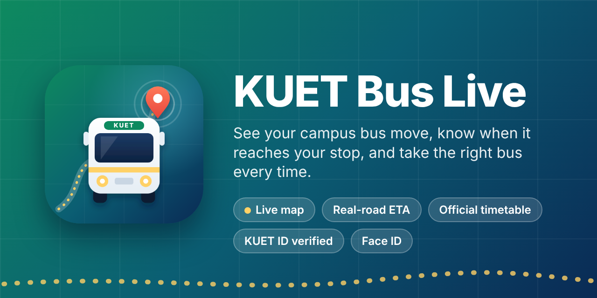
</p>

# KUET Bus Live

[](https://github.com/shadowfax-505/KUETBusLive/actions/workflows/build.yml)


**See your campus bus move on a map, know exactly when it reaches your stop, and never chase the wrong bus again.**

**Author:** Muttakin Rahman Shoscho ([shadowfax-505](https://github.com/shadowfax-505))
**Course:** CSE 3218 Mobile Computing Lab, KUET (Open-Ended Project)

---

## Contents

1. [Why I built this](#why-i-built-this)
2. [What the app does](#what-the-app-does)
3. [Who uses it](#who-uses-it)
4. [The big picture](#the-big-picture)
5. [How the code is organised](#how-the-code-is-organised)
6. [Signing up and KUET ID verification](#signing-up-and-kuet-id-verification)
7. [Which bus can I take?](#which-bus-can-i-take)
8. [Live tracking, step by step](#live-tracking-step-by-step)
9. [How the ETA is calculated](#how-the-eta-is-calculated)
10. [Route paths and the live trip card](#route-paths-and-the-live-trip-card)
11. [App lock: Face ID and passcode](#app-lock-face-id-and-passcode)
12. [Animations and feel](#animations-and-feel)
13. [The arrival alert](#the-arrival-alert)
14. [The bus timetable](#the-bus-timetable)
15. [Crowd reports](#crowd-reports)
16. [Background location for drivers](#background-location-for-drivers)
17. [Home screen widget](#home-screen-widget)
18. [Live Activity and Dynamic Island](#live-activity-and-dynamic-island)
19. [Trip progress, like a parcel tracker](#trip-progress-like-a-parcel-tracker)
20. [Route editor (admin)](#route-editor-admin)
21. [Announcements](#announcements)
22. [Bangla, dark mode and accessibility](#bangla-dark-mode-and-accessibility)
23. [Server push (FCM)](#server-push-fcm)
24. [Screens and navigation](#screens-and-navigation)
25. [Listeners, onAppear and onDisappear](#listeners-onappear-and-ondisappear)
26. [Firestore data model](#firestore-data-model)
27. [Security rules](#security-rules)
28. [Course topics used](#course-topics-used)
29. [Continuous integration](#continuous-integration)
30. [Setup](#setup)
31. [Running a demo with two simulators](#running-a-demo-with-two-simulators)
32. [News controls](#news-controls)
33. [Complaints](#complaints)
34. [Bangla stop and place names](#bangla-stop-and-place-names)
35. [My places and waving down a bus](#my-places-and-waving-down-a-bus)
36. [Smart suggestions](#smart-suggestions)
37. [Drivers and bus assignment](#drivers-and-bus-assignment)
38. [Smart assistant (on this iPhone)](#smart-assistant-on-this-iphone)
39. [Privacy](#privacy)
40. [App Store readiness](#app-store-readiness)
41. [Limitations and ideas for later](#limitations-and-ideas-for-later)

---

## Why I built this

Anyone who has waited for a KUET bus knows the feeling. You leave the hall early, stand at Fulbarigate or Shibbari, and keep looking down the road without knowing whether the bus left five minutes ago or hasn't left campus yet. The timetable on the website helps, but it doesn't tell you where the bus is *right now*, whether it's packed, or whether that bus is even one you're allowed to ride.

KUET Bus Live answers those three questions:

- **Where is my bus?** The driver's phone shares its location, and everyone sees it move live.
- **When will it reach me?** The app asks a routing server for the real driving time to your stop.
- **Can I get on it?** Student buses and teacher buses are kept separate, so you only see the buses you can actually take.

---

## What the app does

| Feature | In one line |
| --- | --- |
| 🗺️ Live map | Every running bus moves on the map as the driver drives. |
| ⏱️ ETA to your stop | "6 min, 5.3 km" to the stop you picked, refreshed as the bus moves. |
| 🔔 Arrival alert | A notification when your bus is close. Each rider chooses how early, from 1 to 30 minutes (5 by default). |
| 📅 Official timetable | All KUET trips (Sunday to Thursday and Saturday), with the next bus you can take today. |
| 🎓 Bus allocation | Students see only *Normal* (student) buses. Teachers can ride any bus. |
| 🪪 KUET ID verification | Roll number or employee ID, KUET email, email link and admin approval. |
| 👥 Crowd reports | One tap to say "Seats available" or "Full", and everyone sees it instantly. |
| 🔒 App lock | Face ID, a 4-digit app passcode, both, or neither. |
| 🛠️ Transport admin | Edits the timetable when KUET changes it, and approves teachers and drivers. |
| 🧭 Route editor | The admin taps the map to add stops, drags them into order and renames them. |
| 📣 Announcements | News from the transport office, with an unread badge and a banner on the map. |
| 📱 Home screen widget | Small, medium and large: the next bus, a progress ring or track, and a route map. |
| 🏝️ Live Activity | Follow a bus on the Lock Screen and in the Dynamic Island, with a trip track. |
| 📍 Background location | The bus keeps moving on the map even when the driver locks the phone. |
| 🇧🇩 Bangla | The whole app in Bangla when the phone (or just this app) is set to Bangla. |
| ♿ Accessibility | VoiceOver labels, dark mode and large text that doesn't break the trip card. |
| 🧪 Unit tests | 28 XCTest tests run on every push in CI. |
| 📨 Server push (ready) | Cloud Function + FCM code for "Normal-2 just left campus", written but not deployed. |

---

## Who uses it

There are four kinds of people in the app. Each one sees a different set of screens.

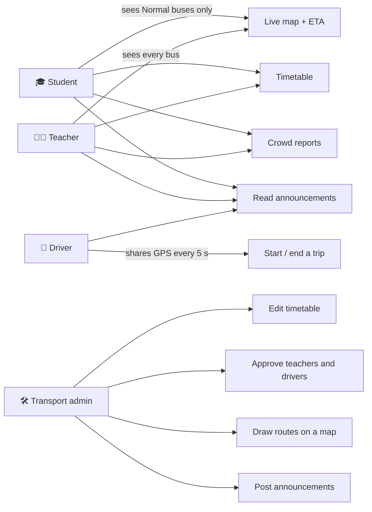

| Role | How they get in | What they do |
| --- | --- | --- |
| **Student** | Roll number + `@stud.kuet.ac.bd` email + email link | Track student buses, set a stop, get ETAs and alerts, report crowd |
| **Teacher** | Employee ID + KUET staff email + email link + admin approval | Same as students, but for every bus |
| **Driver** | Driver ID + admin approval | Pick today's trip and share the bus location |
| **Transport admin** | Set up by the transport office in Firebase | Keep the timetable up to date, approve accounts, draw routes, post announcements |

---

## The big picture

The app talks to three outside services: **Firebase Authentication** for accounts, **Cloud Firestore** as a live database, and the **OSRM routing API** for travel times. Nothing runs on a server of my own. The driver's phone writes, and every rider's phone listens.

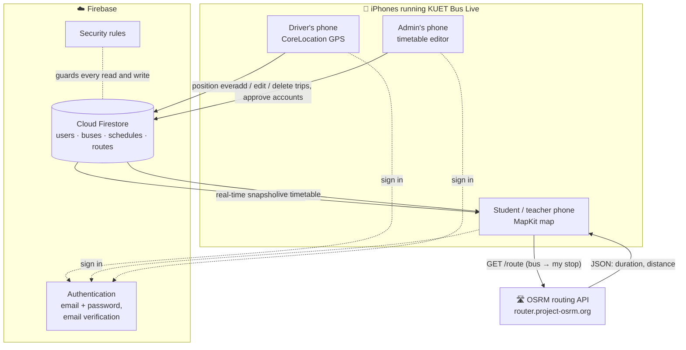

The key idea is that **nobody polls**. Firestore pushes every change to the phones that are listening, so a bus moving on the driver's phone shows up on everyone's map about a second later.

---

## How the code is organised

The app follows **MVVM** (Model, View, ViewModel), the same pattern used in the lab classes.

- **Models** are plain `struct`s that match Firestore documents.
- **ViewModels** are `ObservableObject` classes. They talk to Firebase and publish data with `@Published`.
- **Views** are SwiftUI screens. They only show what the view model publishes.
- **Services** wrap system frameworks: GPS, notifications, the routing API, and the KUET ID rules.

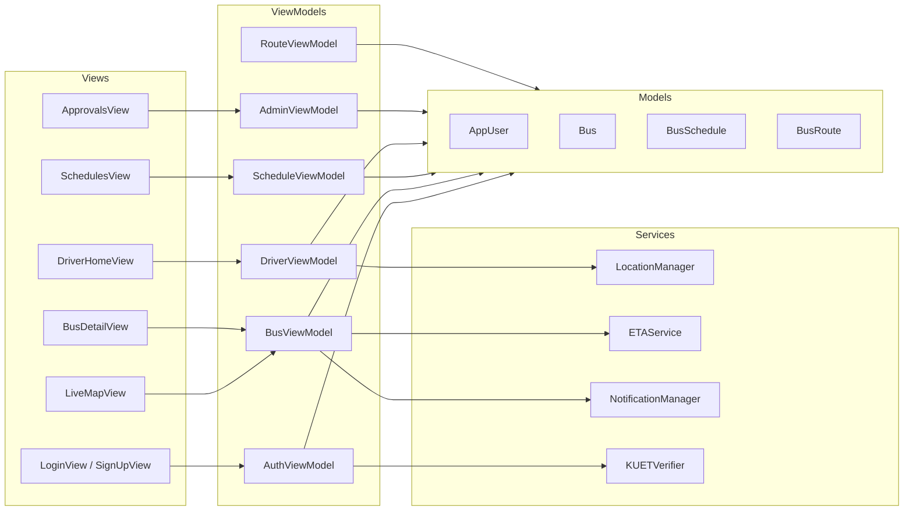

```
KUETBusLive/
├── KUETBusLiveApp.swift        App entry, configures Firebase
├── ContentView.swift           Picks the first screen (login, verify, waiting, or the role's tabs)
├── Models/
│   ├── AppUser.swift           User profile + UserRole enum
│   ├── Bus.swift               A running bus + CrowdLevel enum
│   ├── BusRoute.swift          A route and its stops
│   ├── BusSchedule.swift       One timetable trip + BusAudience, TripDays, TripPeriod
│   ├── Timetable.swift         Reads kuet_schedule.json
│   └── RouteResponse.swift     OSRM JSON response
├── Services/
│   ├── LocationManager.swift   GPS, with a custom delegate protocol
│   ├── ETAService.swift        Calls the OSRM REST API
│   ├── NotificationManager.swift  Local arrival alerts
│   └── KUETVerifier.swift      Roll number and KUET email rules
│   ├── LiveActivityManager.swift  Starts, updates and ends the Live Activity
│   ├── WidgetSync.swift        Writes widget data to the App Group
│   └── PushManager.swift       FCM token, route topics, AppDelegate
├── ViewModels/                 Auth, Bus, Driver, Route, Schedule, Admin, Announcement
└── Views/                      All SwiftUI screens (incl. RouteEditorView, AnnouncementsView)

Shared/                         Compiled into both the app and the widget (no Firebase here)
├── SharedTrip.swift            Widget data + the App Group store
├── TripProgress.swift          Where the bus is between KUET and my stop (0...1)
├── TripProgressView.swift      The track and the ring
├── BusTripAttributes.swift     Live Activity data
├── Localizable.xcstrings       English + Bangla text
└── kuet_schedule.json          Official KUET timetable

KUETBusWidget/                  WidgetKit extension: widget, Live Activity, map snapshot
KUETBusLiveTests/               XCTest unit tests
functions/                      Cloud Function for push (not deployed)
```

---

## Signing up and KUET ID verification

When you create an account, the app checks your KUET details **before** it creates anything in Firebase. `KUETVerifier.validate` uses a `switch` on your role:


Signing up isn't the end of it. Every time the app starts, `ContentView` decides which screen you should see. Because the profile is loaded with a **live listener**, the moment the admin approves you, your phone moves past the waiting screen by itself. You don't need to sign out and back in.

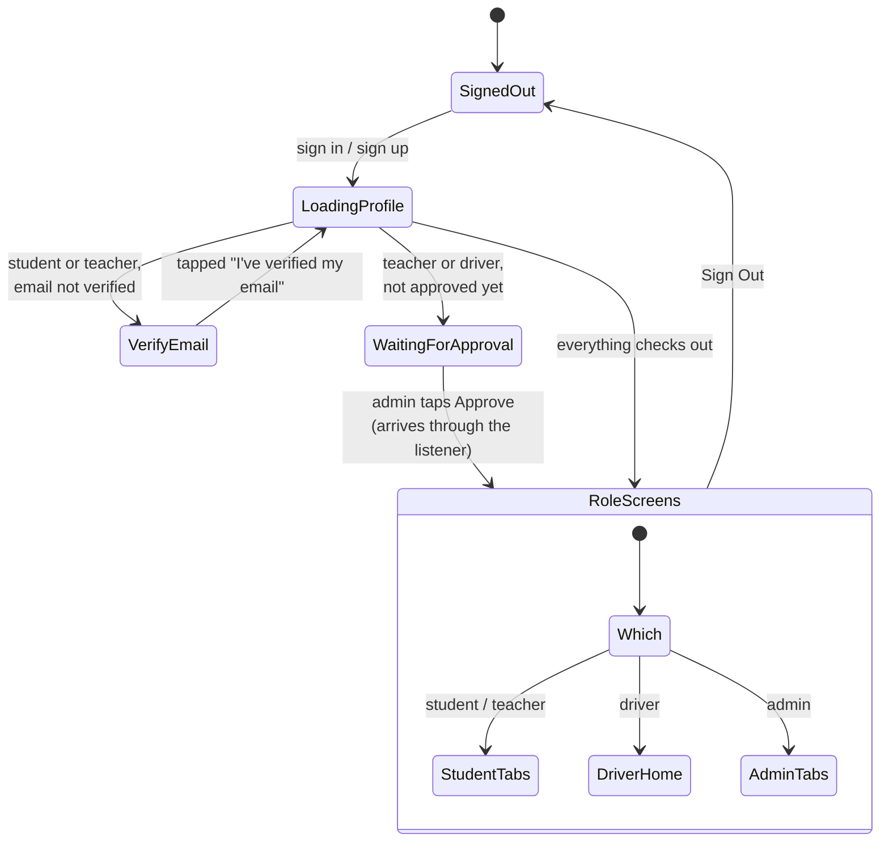

> **Demo accounts:** debug builds also accept `@test.com` emails and skip the email link, so the app can be shown in the lab without real KUET mailboxes. Release builds never accept them.

---

## Which bus can I take?

KUET runs two kinds of trips:

- **Normal** trips (Normal-1, Normal-2) are **student buses**.
- **Special** trips (Special-1, Special-1 (AC)) are **teacher buses**.

Teachers can get on any bus. Students can only get on student buses. The whole rule is one small function, `BusAudience.canBoard(_:)`:

```swift
func canBoard(_ role: UserRole) -> Bool {
    switch role {
    case .teacher, .driver, .admin:
        return true
    case .student:
        return self == .student
    }
}
```

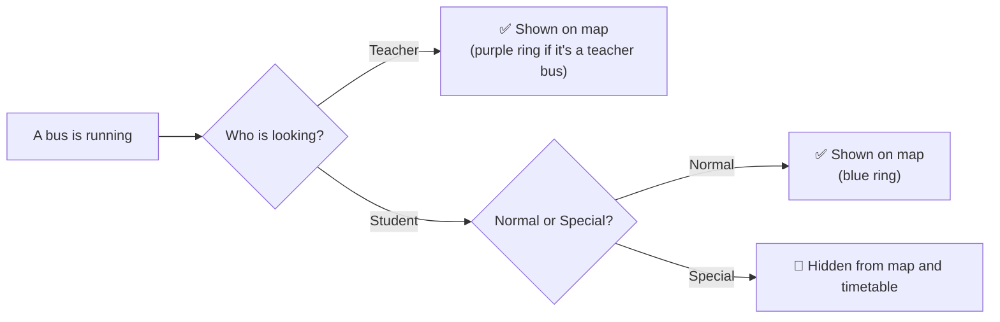

The same rule is used in four places, so it can't be dodged:

1. `BusViewModel` filters the buses on the map.
2. `ScheduleViewModel` filters the timetable.
3. `BusDetailView` hides the crowd buttons if you can't ride that bus.
4. `firestore.rules` rejects a crowd report from a student on a teacher bus, even if someone edits the app.

---

## Live tracking, step by step

This is the heart of the app. It uses the **delegate pattern** twice: Apple's `CLLocationManagerDelegate`, and my own `LocationUpdateDelegate` protocol, so the GPS code stays separate from the Firebase code.

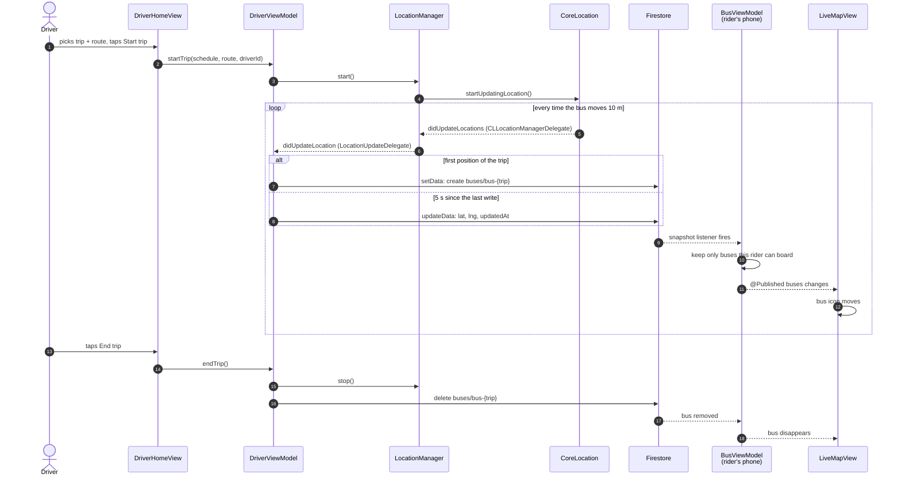

Two small choices here are worth calling out:

- **Writes are limited to one every 5 seconds.** GPS can fire many times a second, and writing every update would waste battery and Firestore quota.
- **Later updates use `updateData`, not `setData`.** That way only the position changes, and crowd reports that riders sent in the meantime aren't overwritten.

---

## How the ETA is calculated

Straight-line distance would be wrong in Khulna's roads, so the app asks **OSRM**, a free routing server, for the actual driving time. The answer comes back as JSON and is decoded with `Codable`.

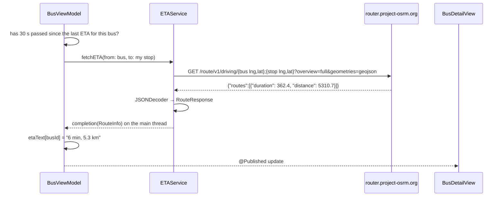

The response is mapped to two small structs:

```swift
struct RouteResponse: Codable {
    let routes: [RouteInfo]
}

struct RouteInfo: Codable {
    let duration: Double            // seconds
    let distance: Double            // metres
    let geometry: RouteGeometry?    // the road path, for the map
}
```

OSRM's public server has fair-use limits, so the app asks **at most once every 30 seconds per bus**, unless you open the bus screen or change your stop.

---

## Route paths and the live trip card

Tapping a bus works the way it does in Uber or Pathao: the map focuses on that one trip and tells you everything about it at a glance.

| What you see | Where it comes from |
| --- | --- |
| The bus's whole route, drawn faintly along the real roads | OSRM, asked once for a path through every stop of the route |
| The road from the bus to **your** stop, drawn strongly | The same OSRM call that gives the ETA, now with `geometries=geojson` |
| Every stop on the route as a small circle | The route document in Firestore |
| The bus gliding smoothly instead of jumping | `withAnimation` around each Firestore update |
| A small arrow showing which way the bus is heading | `CLLocation.course`, sent by the driver's phone |
| Speed in km/h | `CLLocation.speed`, sent by the driver's phone |
| "Near Daulatpur · stop 3 of 5" and a progress bar | The stop closest to the bus right now |
| "Updated 4 s ago" counting up every second | `TimelineView(.periodic(by: 1))` |
| A warning when the bus has been silent for over a minute | `Bus.isStale` |
| Follow mode, where the camera stays on the bus | `MapCamera`, moved on every new position |
| Your own blue dot and a "locate me" button | `UserAnnotation` and `MapUserLocationButton` |

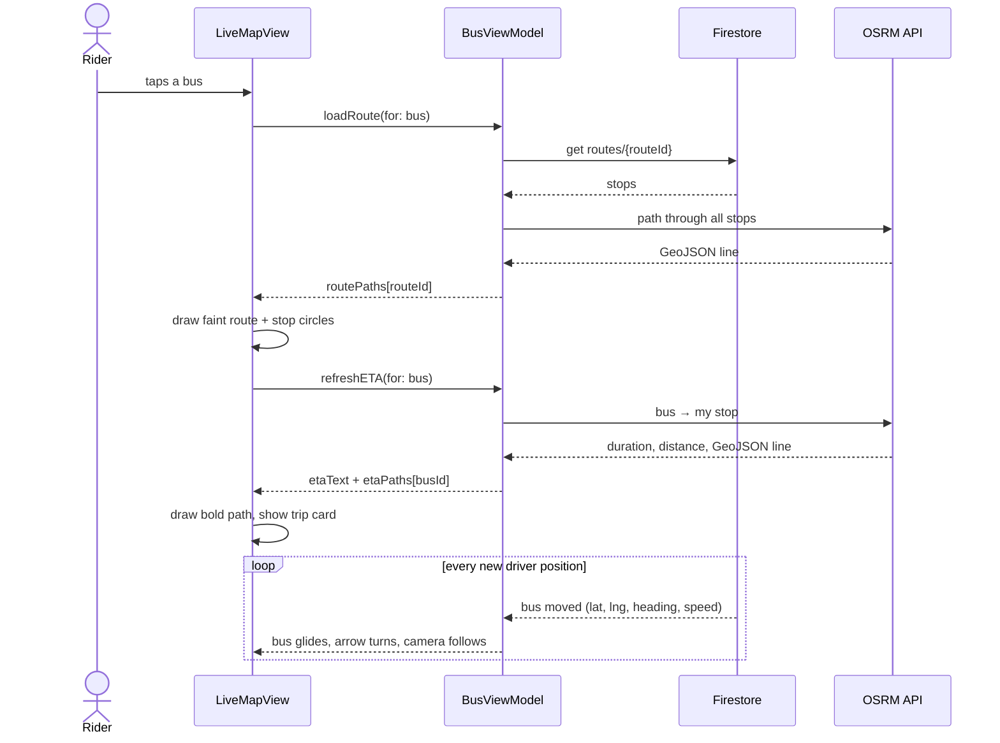

GeoJSON lists each point as `[longitude, latitude]`, the opposite of CoreLocation, so `RouteGeometry` swaps them before drawing:

```swift
rawCoordinates.compactMap { pair in
    CLLocationCoordinate2D(latitude: pair[1], longitude: pair[0])
}
```

The driver gets a small map too: the chosen route is drawn above the trip controls, with their own position on it, so they can check they picked the right route before starting.

### Why this helps

- **Less guessing.** A dot on a map tells you where the bus is. The highlighted road and the "stop 3 of 5" bar tell you how far it still has to go, which is what you actually need when deciding whether to run.
- **Trust in the data.** The live "updated 4 s ago" counter and the stale warning show when the information is fresh, so nobody waits for a bus whose driver lost signal ten minutes ago.
- **One glance, no taps.** Everything sits on one card over the map, like a ride-hailing app, instead of being spread across screens.

---

## App lock: Face ID and passcode

Your account shows your KUET ID and email, so the app can lock itself like a banking app. In **Profile > App lock** there are two separate switches, and you can turn on **both, either one, or neither**:

| Your choice | What happens when you open the app |
| --- | --- |
| Neither | Straight into the app |
| Face ID only | Face ID prompt; if it fails, iOS asks for the phone's own passcode |
| App passcode only | A 4-digit number pad, like the iPhone lock screen |
| Both | Face ID first; if it fails or you cancel, the app's passcode pad is the backup |

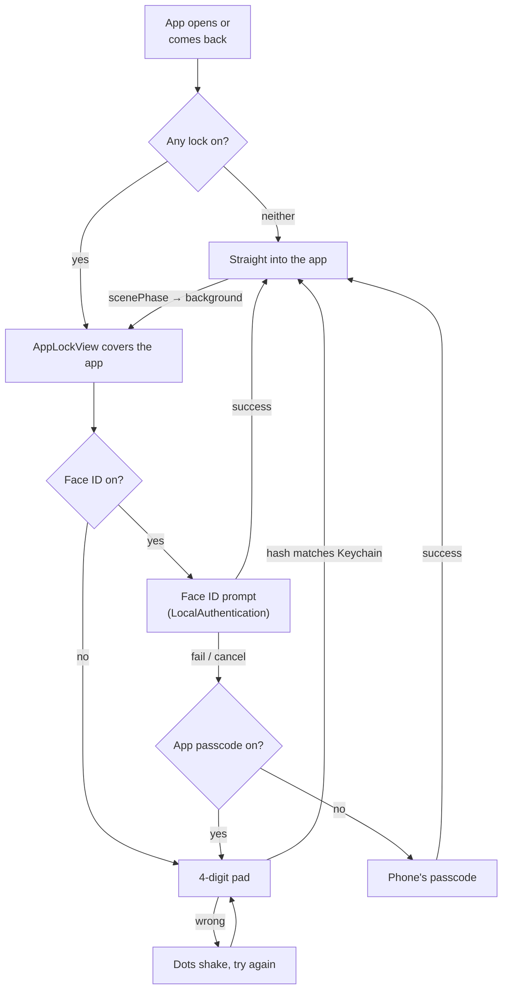

| Piece | What it does |
| --- | --- |
| `BiometricAuth` | Wraps `LAContext`: finds out whether the phone has Face ID or Touch ID, and shows the prompt |
| `AppPasscode` | Saves only a **SHA-256 hash** of the passcode (CryptoKit), in the **iOS Keychain**, readable only on this phone |
| `PasscodePad` | The number pad and dots, with a shake animation and a vibration for a wrong code |
| `SetPasscodeView` | Type a new passcode, then type it again to confirm |
| `AppLockView` | The lock screen, which uses whichever locks you turned on |
| `ContentView` | Watches `scenePhase` and locks again when the app goes to the background |
| `ProfileView` | The two switches, saved with `@AppStorage`. Face ID is checked once before it turns on, so you can't lock yourself out |

Forgot your passcode? **Forgot? Sign out** on the lock screen removes the locks and signs you out, and your KUET account password gets you back in. The app never sees your face, and the passcode itself is never stored, only its hash.

---

## Animations and feel

Small touches that make the app feel alive without getting in the way:

| Where | What moves |
| --- | --- |
| Opening the app | The logo springs in while a dotted route draws itself, then the app fades in (`SplashView`) |
| Between screens | Login, waiting, verify and the main tabs cross-fade instead of snapping |
| Map | Every running bus has a ring that keeps spreading out; buses glide between GPS updates; the selected bus springs up in size |
| Trip card | The ETA digits roll to the new value (`.numericText()`), the live signal icon pulses, the crowd icon bounces on a new report, and the phone gives a light tap (`sensoryFeedback`) |
| Waiting for approval | The hourglass pulses |

---

## The arrival alert

If you turn on **"Alert me before my bus arrives"** in your profile, a **"How early"** stepper appears where you pick anything from 1 to 30 minutes (5 by default). The choice is saved on the phone with `@AppStorage`, and every new ETA is checked against it. The alert fires once per bus, so it won't keep buzzing.

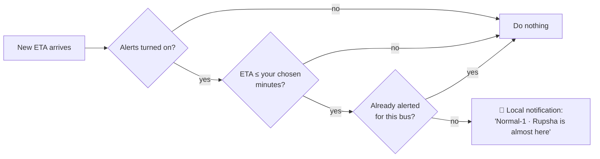

`NotificationManager` is the `UNUserNotificationCenterDelegate`, so the banner shows even while the app is open.

---

## The bus timetable

The official timetable is on [kuet.ac.bd/transport](https://www.kuet.ac.bd/transport), and it changes from time to time. So it isn't hard-coded into the screens. It lives in Firestore, where the transport admin can change it from inside the app, and every phone sees the change straight away.

The first copy ships with the app as `kuet_schedule.json`: 31 trips across Sunday to Thursday and Saturday, split into morning, noon, afternoon and night.

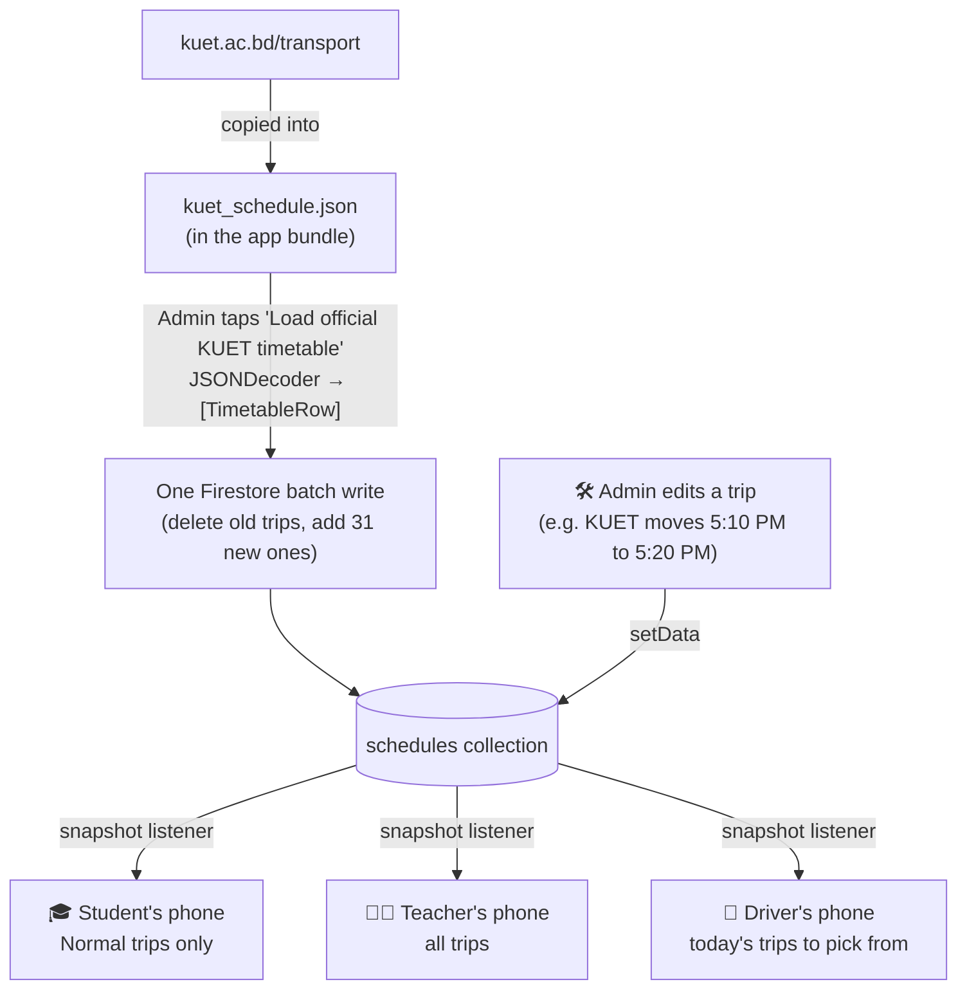

Each trip looks like this in the JSON file:

```json
{
  "tripName": "Normal-1",
  "days": "sunToThu",
  "period": "morning",
  "campusTime": "06:30",
  "spot": "Rupsha",
  "spotTime": "07:10",
  "remarks": "Will back via Royal Mor & Ferighat"
}
```

There's no `audience` field in the file. The app works it out from the name: anything starting with "Special" is a teacher bus. The admin's editor does the same, so typing "Special-2" flips the badge to *Teacher bus* automatically.

The timetable screen also shows **"Next bus you can take today"**. It checks today's weekday (Sunday to Thursday, Saturday, or no buses on Friday), compares the times with the clock, and only looks at trips your role can ride.

---

## Crowd reports

Anyone allowed on a bus can tap **Seats available** or **Full**. The report is a single field update on the bus document, so it reaches every other rider almost instantly, and the bus icon on the map changes colour.

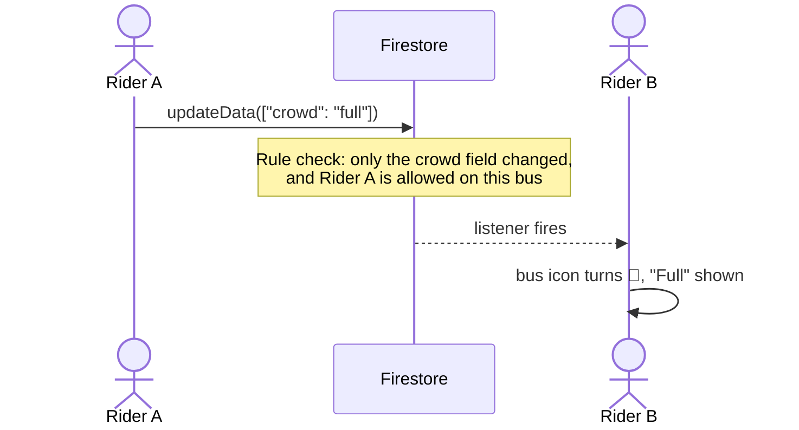

| Crowd level | Map colour |
| --- | --- |
| No report yet | ⚪ grey |
| Seats available | 🟢 green |
| Full | 🔴 red |

---

## Background location for drivers

Drivers don't keep staring at their phone while driving. They start the trip, put the phone in the holder, and maybe lock it. Before, the bus froze on everyone's map the moment the driver's screen turned off. Now GPS keeps going for the whole trip.

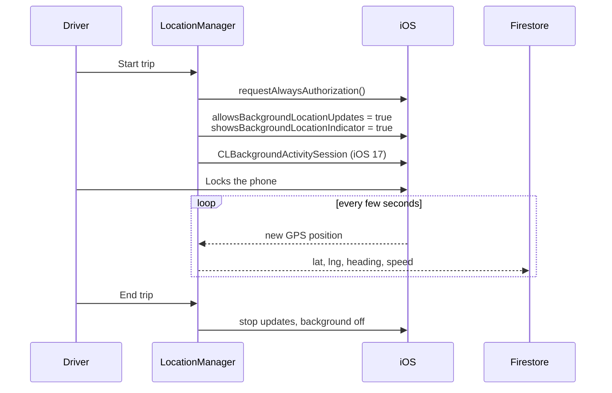

- `UIBackgroundModes` → `location` is set in `KUETBusLive-Info.plist`, and the "Always" permission text explains why.
- Background updates are only switched on **while a trip runs**. Ending the trip turns them off again.
- iOS shows the blue location pill at the top of the screen the whole time, so the driver always knows their location is being shared.
- `pausesLocationUpdatesAutomatically = false`, because a bus waiting at Daulatpur signal is still on its trip.
- If the driver only allows "While Using", tracking still keeps going: it was started while the app was open, and the blue pill stays on.

I tested it with two simulators: the driver started a trip on a simulated route and went to the home screen, and the bus kept moving on the student's map.

---

## Home screen widget

A **WidgetKit** extension (`KUETBusWidget`) shows the next bus without opening the app. It comes in three sizes.

| Size | What it shows |
| --- | --- |
| Small | A progress ring with the minutes left in the middle, plus the bus name |
| Medium | The bus, its ETA and crowd, and a track from KUET to my stop |
| Large | A map of my route with the bus on it, then the same track, ETA and crowd |

<p align="center">
  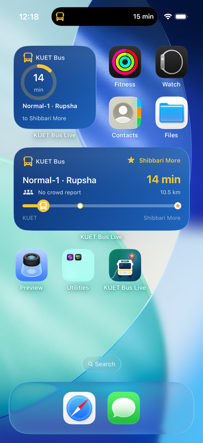
  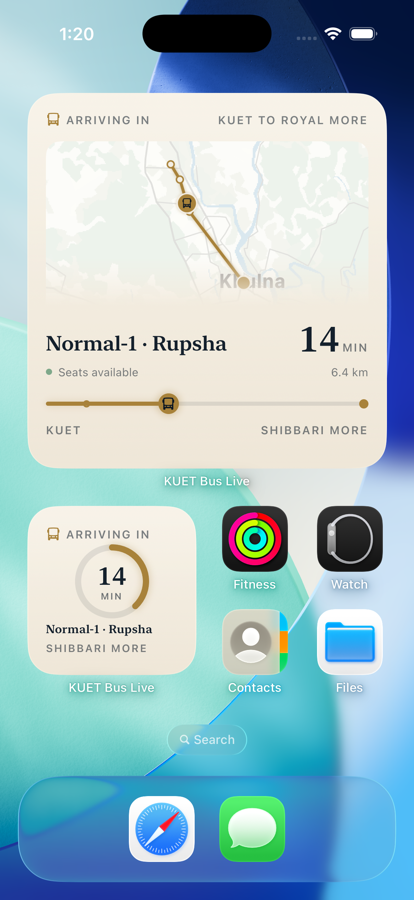
  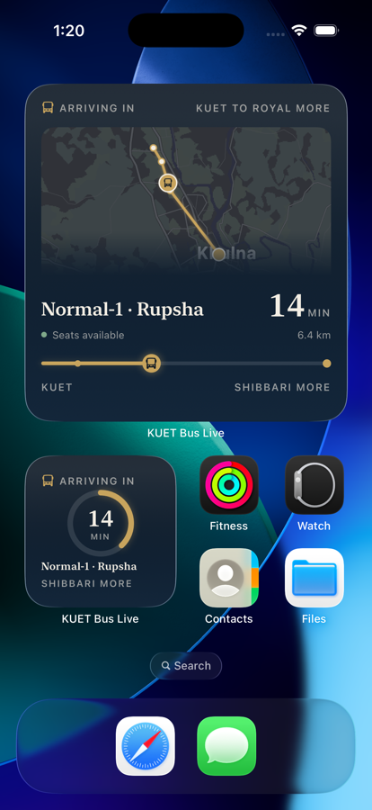
</p>

**Look.** The colours live in one file, `KUETBusWidget/WidgetTheme.swift`, with a light and a dark version of each:

| | Dark | Light |
| --- | --- | --- |
| Background | `#1C1C1E` | white to `#F2F2F7` |
| Text | white (60% for small text) | near-black `#111111` (55% for small text) |
| Ring, track, bus | white | near-black `#111111` |

Everything is black and white, like the live map. Colour is kept for status only: green for seats free, red for full or no signal, with amber kept in the theme for a "filling up" level. Bus names and big numbers are set in the serif New York face with even-width digits, and the small labels ("ARRIVING IN", "NEXT BUS") are uppercase with wide letter spacing. The large widget's map is a muted, mostly grey snapshot with the route drawn as one solid line (black, or white on the dark map), a square at the first stop and a ring at my stop. The accent parts are marked `widgetAccentable()`, so they take the tint colour on a tinted home screen. The Live Activity always uses a near-black background with white text, and the Dynamic Island keylines are white.

The widget is a separate small program, so it can't read the app's memory or Firestore. The app and the widget share data through an **App Group**: a `UserDefaults` that both can open (`group.KUETBusLive`).

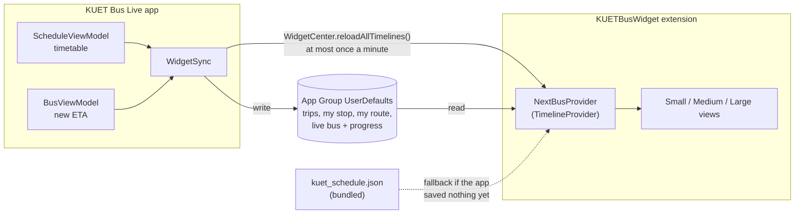

- **Timeline:** the provider gives WidgetKit one entry for now and one for the moment each of the next few buses leaves, so the widget moves on to the next bus by itself. The countdown (`Text(date, style: .relative)`) counts down on its own.
- **Live data first:** while a bus is running, the app saves its ETA, distance, crowd and position. If that is older than 10 minutes, the widget goes back to the timetable.
- **Large widget map:** a widget can't show a live MapKit map, so `RouteMapRenderer` uses `MKMapSnapshotter` to take a still picture of the map, then draws the route line, the stops, my stop (orange) and the bus on top. It makes a light and a dark picture, and the widget picks the one that matches the phone. If the snapshot fails or no route is saved, the large widget shows the ring instead.
- **Battery:** widgets have a daily refresh budget, so the app asks for a redraw at most once a minute.

> **Signing note:** the App Group works in the simulator without any team. On a real iPhone, choose your team in **Signing & Capabilities** for both the app and the `KUETBusWidget` target, and let Xcode register `group.KUETBusLive` (or change it to `group.<your bundle id>` in both entitlements files and in `SharedStore.appGroup`).

---

## Live Activity and Dynamic Island

On the trip card there is a **Follow on Lock Screen** button. It starts a **Live Activity**: the bus, the ETA and the trip track sit on the Lock Screen and in the Dynamic Island, so a student waiting at Fulbarigate doesn't need to keep the app open.

<p align="center">
  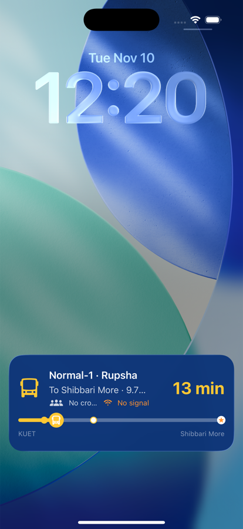
  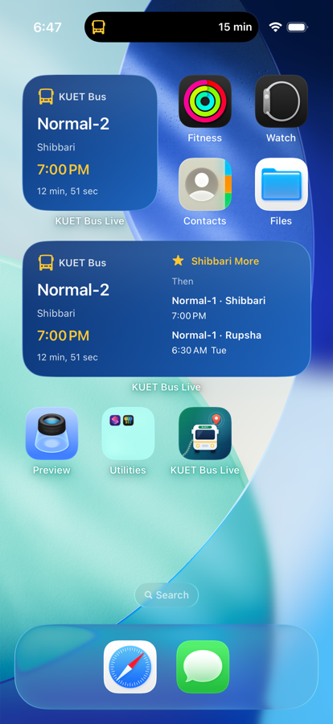
  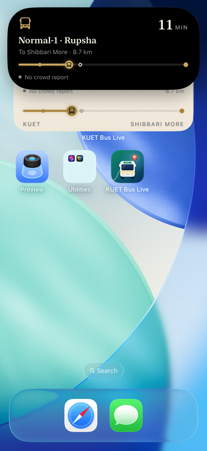
</p>

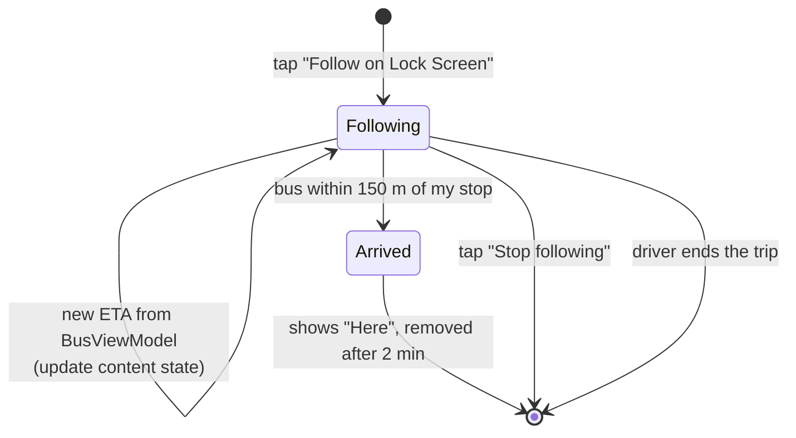

| Part | Where | Shows |
| --- | --- | --- |
| `BusTripAttributes` | `Shared/` | Fixed for the whole activity: bus number and my stop |
| `ContentState` | `Shared/` | Changes on every update: ETA minutes, distance, crowd, no-signal flag, trip progress |
| `LiveActivityManager` | app | Starts (`Activity.request`), updates and ends the activity |
| `BusLiveActivity` | widget extension | Lock Screen view, and the compact, minimal and expanded Dynamic Island views |

The app sends the updates itself (`pushType: nil`), so the ETA changes while the app can run. With the app fully closed, updates would need push notifications from a server (see [Server push](#server-push-fcm)).

---

## Trip progress, like a parcel tracker

Text like "7 min, 3.2 km" is useful, but a picture is quicker to read. `TripProgressView` draws a track from **KUET** to **my stop**, with a dot for every stop on the way, a filled part for the distance already covered, and a small bus where the bus is now. `TripProgressRing` shows the same number as a ring.

The same views are used in four places, because `Shared/` is compiled into both the app and the widget extension: the trip card, the medium and large widgets, the Lock Screen, and the expanded Dynamic Island (a thin version).

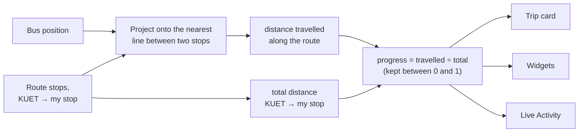

When there is no live bus, the widget uses the timetable instead: the time since the bus left campus divided by a typical trip length.

---

## Route editor (admin)

The transport admin can now build routes in the app instead of in the Firebase console. In **Routes**, the **+** button creates a route and tapping a route opens it for editing.

- **Tap the map to add a stop.** `MapReader` gives a `MapProxy`, and `proxy.convert(point, from: .local)` turns the spot the finger touched into a latitude and longitude.
- **Rename** stops in the list, **drag** them into order (tap **Edit**), and **swipe** to delete.
- **Save** writes the whole route to the `routes` collection. Riders see the change straight away because their screens use live listeners.

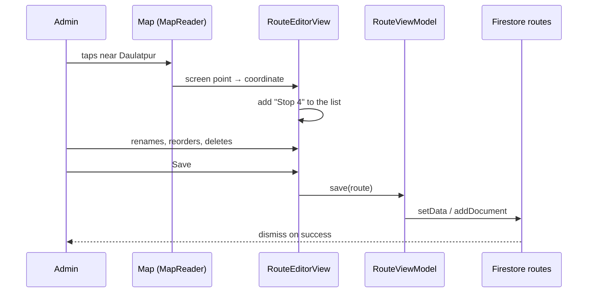

---

## Announcements

The transport office can post news like "Normal-2 is 15 minutes late today". Everyone signed in sees it, newest first, through a live listener.

| Who | Where |
| --- | --- |
| Admin | **News** tab, **compose** button to post, swipe to delete |
| Students and teachers | **News** tab with a red **unread badge**, and a banner for the newest one on the map |
| Drivers | Megaphone button on the driver screen, with a red dot for unread news |

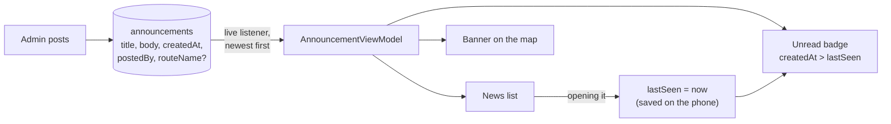

"Unread" is worked out on each phone: it remembers when the list was last opened, and counts the announcements posted after that.

---

## Bangla, dark mode and accessibility

**Bangla.** All text in the app, the widget and the Live Activity lives in one **String Catalog** (`Shared/Localizable.xcstrings`) with English and Bangla (`bn`). Bus names like Normal-1 and place names like Rupsha stay as they are. The app follows the phone's language; **Profile > Language** explains how to switch, including picking Bangla for this app only in Settings.

<p align="center">
  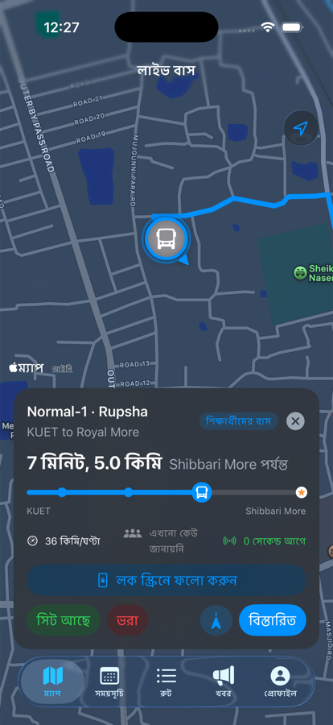
  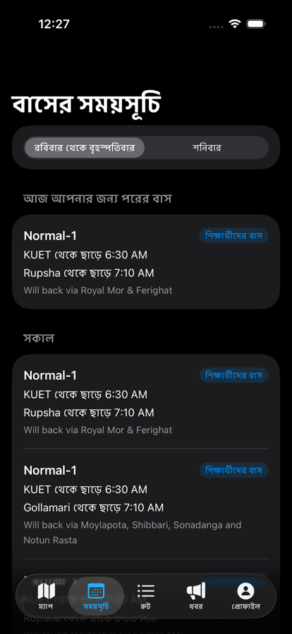
  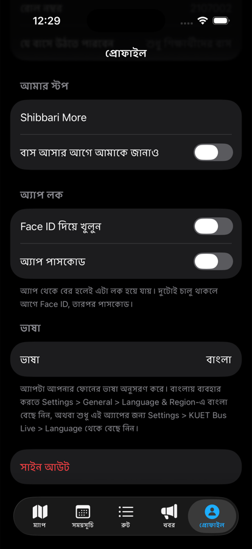
</p>

**Dark mode.** The screens use system colours (`.primary`, `.secondary`, materials), so they adapt by themselves. I checked every main screen in dark mode. The widgets switch between white and `#1C1C1E`, the Live Activity stays near-black in both modes, and the large widget's map picture has a dark version.

**VoiceOver.** Bus markers read as "Normal-1 · Rupsha, Student bus, Seats available", the passcode dots read "2 of 4 digits entered", the delete key and every icon-only button have names, and the progress track reads "45 percent of the way from KUET to Shibbari More".

**Large text.** With the biggest accessibility text sizes, the trip card stacks its rows instead of squeezing them, and scrolls instead of covering the whole map.

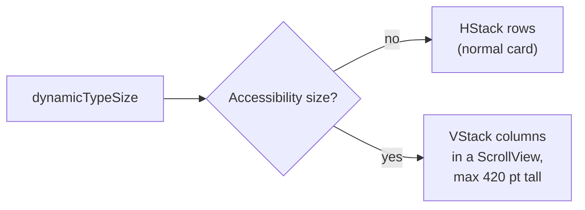

---

## Server push (FCM)

Local notifications only fire while the app is running. To tell riders "**Normal-2 just left campus**" even when the app is closed, a server has to send a push notification. This part is **written but not deployed**, because Cloud Functions need Firebase's paid Blaze plan.

```mermaid
sequenceDiagram
    participant R as Rider's app
    participant FCM as Firebase Cloud Messaging
    participant D as Driver's app
    participant FS as Firestore
    participant CF as Cloud Function
    R->>FCM: APNs token → FCM token
    R->>FS: users/{uid}.fcmToken
    R->>FCM: subscribe to topic "route-{routeId}"
    D->>FS: create buses/{id} (Start trip)
    FS->>CF: onDocumentCreated("buses/{busId}")
    CF->>FCM: send to "route-{routeId}"
    FCM-->>R: "Normal-2 · Rupsha just left campus"
```

- **App:** `PushManager` registers for remote notifications, saves the FCM token on the profile, and subscribes the rider to the topic of the route that has their stop. `AppDelegate` passes the APNs token to Firebase.
- **Server:** `functions/index.js` has one function, `notifyTripStarted`.

**To turn it on:**

1. Upgrade the Firebase project to the **Blaze** plan (Cloud Functions need it; light use stays inside the free quota).
2. In Xcode, add the **Push Notifications** capability to the app target (needs a paid Apple Developer team). It isn't added in the repository because a free personal team can't sign it.
3. In the Apple Developer site, create an **APNs Authentication Key** (.p8). In the Firebase console, open **Project settings > Cloud Messaging > Apple app configuration** and upload the key with its Key ID and Team ID.
4. Deploy the function:
   ```
   cd functions && npm install && cd ..
   firebase deploy --only functions
   ```
5. Run the app on a real iPhone (the simulator can't get a real APNs token), set a stop, and start a trip from a driver account. The rider gets the notification.

---

## Screens and navigation

```mermaid
flowchart TD
    CV{"ContentView"} -->|signed out| LOGIN["LoginView"]
    LOGIN -->|NavigationLink| SIGNUP["SignUpView"]
    CV -->|email not verified| VERIFY["VerifyEmailView"]
    CV -->|waiting for admin| WAIT["PendingApprovalView"]

    CV -->|student / teacher| ST["StudentTabView"]
    ST --> T1["🗺️ Map<br/>LiveMapView"]
    T1 -->|tap a bus| BUS["BusDetailView<br/>ETA · crowd · allocation"]
    ST --> T2["📅 Schedule<br/>SchedulesView"]
    ST --> T3["📍 Routes<br/>RoutesListView"]
    T3 --> RD["RouteDetailView<br/>'Set as my stop'"]
    ST --> T4["👤 Profile<br/>ProfileView"]

    CV -->|driver| DR["DriverHomeView<br/>pick trip · Start / End trip"]

    CV -->|admin| AT["AdminTabView"]
    AT --> A1["📅 Schedule + editor sheet"]
    AT --> A2["✅ Approvals"]
    AT --> A3["🗺️ Map"]
    AT --> A4["📍 Routes"]
    AT --> A5["👤 Profile"]
```

---

## Listeners, onAppear and onDisappear

Every live list in the app follows the same pattern: start listening when the screen appears, and remove the listener when it goes away. This keeps the app from downloading updates for screens nobody is looking at.

```mermaid
sequenceDiagram
    participant View as SchedulesView
    participant VM as ScheduleViewModel
    participant FS as Firestore

    View->>VM: .onAppear → startListening()
    VM->>FS: addSnapshotListener
    FS-->>VM: current trips
    FS-->>VM: ...every later change
    View->>VM: .onDisappear → stopListening()
    VM->>FS: listener.remove()
```

| Screen | What it listens to |
| --- | --- |
| `LiveMapView` | running buses |
| `SchedulesView` | the timetable |
| `RoutesListView` | routes and stops |
| `DriverHomeView` | routes and today's trips (also ends the trip if you leave) |
| `ApprovalsView` | teachers and drivers waiting for approval |
| `AuthViewModel` | your own profile (so approval shows up instantly) |

---

## Firestore data model

Every collection, field and rule is listed in a platform-neutral way in **[docs/data-model.md](docs/data-model.md)** (also the starting point for an Android version, see [docs/android-plan.md](docs/android-plan.md)). The diagram below shows the original core collections; the newer ones are `fleet`, `driverAbsences`, `trips`, `complaints`, `users/{uid}/places`, `users/{uid}/rideHistory` and `buses/{busId}/waves`.

```mermaid
erDiagram
    USERS {
        string id "Auth uid"
        string name
        string email
        string role "student, teacher, driver, admin"
        string kuetId "roll / employee / driver ID"
        bool isApproved
        string favoriteStopName
        double favoriteStopLat
        double favoriteStopLng
        string fcmToken "for push, optional"
    }
    ANNOUNCEMENTS {
        string id "auto"
        string title
        string body
        timestamp createdAt
        string postedBy "admin's name"
        string routeName "optional"
    }
    SCHEDULES {
        string id "auto"
        string tripName "Normal-1, Special-1 (AC)"
        string audience "student or teacher"
        string days "sunToThu or saturday"
        string period "morning, noon, afternoon, night"
        string campusTime "06:30"
        string spot "Rupsha"
        string spotTime "07:10"
        string remarks
    }
    ROUTES {
        string id "auto"
        string name
        array stops "name, lat, lng"
    }
    BUSES {
        string id "bus-{scheduleId}"
        string number "Normal-1 · Rupsha"
        string routeId
        string routeName
        string driverId
        double lat
        double lng
        timestamp updatedAt
        string crowd "unknown, seats, full"
        string audience
        string scheduleId
        double heading "degrees from north"
        double speed "metres per second"
    }

    USERS ||--o{ BUSES : "a driver runs"
    SCHEDULES ||--o| BUSES : "a trip becomes"
    ROUTES ||--o{ BUSES : "a bus follows"
```

A `buses` document only exists while a trip is running. Ending the trip deletes it, which is how the bus disappears from every map.

---

## Security rules

The checks in the app are friendly, but the real protection is `firestore.rules`, which Firebase runs on the server for every request.

```mermaid
flowchart TB
    REQ["Read / write request"] --> SIGNED{"Signed in?"}
    SIGNED -->|no| DENY["🚫 Denied"]
    SIGNED -->|yes| WHAT{"Which collection?"}

    WHAT -->|users| U{"Own profile?"}
    U -->|"create"| UC["your own email, role must be<br/>student / teacher / driver,<br/>only students start approved"]
    U -->|"update"| UU["only your stop, name and push token<br/>(admin can change anything)"]
    U -->|"delete"| UD["your own profile, or admin"]

    WHAT -->|"schedules / routes / announcements"| SR["everyone reads,<br/>only admin writes"]

    WHAT -->|buses| B{"What kind of write?"}
    B -->|create| BC["only an approved driver,<br/>as themselves, known fields only"]
    B -->|"update position"| BU["only the bus's own approved driver"]
    B -->|"update crowd"| BCR["only the crowd field, a known level,<br/>approved riders allowed on that bus"]

    WHAT -->|"anything else"| DENY
    B -->|delete| BD["the bus's driver or admin"]
```

In plain words: nobody can make themselves an admin, nobody can approve themselves, only approved drivers can put a bus on the map, a student can't touch a teacher bus, only the admin can change routes or post announcements, and any collection the app doesn't use is closed. Every one of these is checked by `firestore-tests/rules.test.js` in the Firestore emulator (see [Continuous integration](#continuous-integration)).

After changing `firestore.rules`, deploy them again with `firebase deploy --only firestore:rules` (or paste them into **Firestore > Rules** in the console). Until then, the News tab shows nothing.

---

## Course topics used

| Topic | Where to find it |
| --- | --- |
| Optionals, `guard let`, `??` | `AppUser.favoriteStop`, `Bus.allocation`, `DriverViewModel.startTrip`, `BusDetailView` |
| `enum` + `switch` | `UserRole`, `BusAudience`, `TripDays`, `TripPeriod`, `CrowdLevel`, `KUETVerifier.validate`, `ContentView` |
| Closures and completion handlers | `AuthViewModel`, `ETAService.fetchETA`, every snapshot listener, `filter` / `sorted` / `map` |
| Structs vs classes, computed and `static` properties | Models are structs, view models are classes; `BusSchedule.isUpcoming`, `ETAService.baseURL` |
| Protocols and the delegate pattern | `LocationUpdateDelegate` (my own), `CLLocationManagerDelegate`, `UNUserNotificationCenterDelegate` |
| `@State`, `@Binding` | `RolePicker`, `DaysPicker`, `AudiencePicker`, `SchedulePicker`, `ArrivalAlertToggle` |
| `@StateObject`, `@ObservedObject`, `@EnvironmentObject`, `@AppStorage` | View models, shared `AuthViewModel`, the alert toggle |
| Navigation | `NavigationStack`, `NavigationLink`, `.navigationDestination`, `TabView`, `.sheet` |
| Firebase Authentication | Sign up, sign in, sign out, email verification |
| Firestore add / read / update / delete | Profiles, trips, routes, buses, approvals, and one batch write |
| JSON parsing | `ETAService` + `RouteResponse` (OSRM REST API) and `Timetable` (`kuet_schedule.json`) |
| `onAppear` / `onDisappear` | Every listener screen in the table above |
| LocalAuthentication, Keychain, CryptoKit | `BiometricAuth`, `AppPasscode`, `AppLockView` |
| SwiftUI animation | `withAnimation`, transitions, `symbolEffect`, `contentTransition`, `sensoryFeedback` |
| MapKit, CoreLocation, local notifications | `LiveMapView` (`MapPolyline`, `Annotation`, `MapCamera`, `UserAnnotation`), `LocationManager`, `NotificationManager` |
| `MapReader` / `MapProxy`, `MKMapSnapshotter` | `RouteEditorView` (tap to add a stop), `RouteMapRenderer` (map picture for the large widget) |
| Background location | `LocationManager` (`allowsBackgroundLocationUpdates`, `CLBackgroundActivitySession`), `KUETBusLive-Info.plist` |
| XCTest unit testing | `KUETBusLiveTests` (verifier, timetable, passcode), run in CI |
| WidgetKit, App Groups | `KUETBusWidget`, `NextBusProvider` (`TimelineProvider`), `SharedStore`, `WidgetSync` |
| ActivityKit (Live Activities, Dynamic Island) | `BusTripAttributes`, `LiveActivityManager`, `BusLiveActivity` |
| Localization (String Catalog) | `Shared/Localizable.xcstrings`, `String(localized:)` |
| Accessibility, Dynamic Type | `accessibilityLabel` / `Value` / `Hint`, `dynamicTypeSize`, `AnyLayout` in `TripCard` |
| Push notifications (FCM, Cloud Functions) | `PushManager`, `functions/index.js` |

---

## Continuous integration

Every push to `main` and every pull request is built on GitHub Actions, so a broken build shows up straight away.

```mermaid
flowchart LR
    PUSH["git push / pull request"] --> GA["GitHub Actions<br/>macOS runner"]
    GA --> X["Select Xcode"]
    X --> PL["Write a placeholder<br/>GoogleService-Info.plist"]
    PL --> SPM["Resolve Firebase packages<br/>(cached)"]
    SPM --> BUILD["xcodebuild for the<br/>iOS Simulator, no signing"]
    BUILD --> SIM["Pick the first iPhone<br/>simulator on the runner"]
    SIM --> TEST["xcodebuild test<br/>(KUETBusLiveTests)"]
    TEST --> BADGE["✅ / ❌ build badge<br/>at the top of this page"]
```

The real `GoogleService-Info.plist` is never committed. CI only needs a placeholder to compile.

A second, much faster job on Ubuntu starts the Firestore emulator and runs `firestore-tests/rules.test.js`: 43 checks that `firestore.rules` lets each person do exactly what they should (for example, a student can't approve themselves, a driver can't move someone else's bus, a student can't report the crowd on a teacher bus, a driver can't start a bus that isn't theirs today, and nobody reads someone else's complaints, places or waves).

### Unit tests

The `KUETBusLiveTests` target (XCTest) checks the parts of the app that are pure logic, so they can run on any simulator without a network or a Firebase account:

| Test file | What it checks |
| --- | --- |
| `KUETVerifierTests` | Roll numbers (7 digits, no future batch), student email must contain the roll, staff email domains, teacher and driver rules, nobody can sign up as admin, the `@test.com` demo rule in debug builds, and that only the two App Review addresses skip the KUET email checks |
| `BusScheduleTests` | `minutes(from:)` with good and bad input, 12-hour formatting, which buses a student or teacher may ride, Friday has no buses, the next-trip logic at fixed times, and that every time in `kuet_schedule.json` parses |
| `AccountDeletionTests` | The last transport admin can't delete their account, the confirmation mentions a driver's running trip, and clearing the phone's settings removes only this app's keys |
| `PlaceNamesTests` | English and Bangla names, the admin's Bangla name winning over the built-in list, bus labels, and that every timetable spot has a Bangla name |
| `PathMathTests` | Snapping a place onto a route, the 300 m warning, riders ahead of or behind the bus, progress towards a place between stops |
| `SmartSuggestionsTests` | Cold start, weekday vs Saturday, the 45-minute window, recency decay, boarding and nearby bonuses, ties, the running-average delay |
| `BusAssignmentTests` | Regular vs cover driver, expired and future covers, no driver, midnight in Dhaka, free drivers for a cover |
| `AssistantTests` | When the assistant is offered and used, unsupported language, rate limit, strict checks on what the model writes, the timetable diff, no personal details in prompts (with a fake model) |
| `AppPasscodeTests` | The passcode hash is a fixed SHA-256 hex string, a wrong code fails, and save / check / remove work in the Keychain (skipped if the simulator has no Keychain access) |

Run them in Xcode with **⌘U**, or from the terminal:

```
xcodebuild test -project KUETBusLive.xcodeproj -scheme KUETBusLive \
  -destination 'platform=iOS Simulator,name=iPhone 17'
```

---

## Setup

1. **Clone and open.** Clone the repository and open `KUETBusLive.xcodeproj` in Xcode 26 or later. Xcode fetches the Firebase packages (**FirebaseAuth**, **FirebaseFirestore**, **FirebaseMessaging**) from `Package.resolved` the first time.
2. **Add your Firebase config.** `GoogleService-Info.plist` isn't in the repository because it holds project keys. In the [Firebase console](https://console.firebase.google.com/), create a project, add an iOS app with the bundle ID `KUETBusLive` (or change the bundle ID to match yours), download `GoogleService-Info.plist`, and put it in the `KUETBusLive/` folder next to `KUETBusLiveApp.swift`.
3. **Turn on Firebase features.** Enable **Authentication > Email/Password**, create a **Firestore** database, put your project ID in `.firebaserc`, then deploy the rules:
   ```
   firebase deploy --only firestore:rules
   ```
4. **Signing.** In **Signing & Capabilities**, choose your team for both the **KUETBusLive** and **KUETBusWidget** targets. Keychain Sharing, the App Group, background location and the Live Activities setting are already in the project. Push Notifications is not; see [Server push](#server-push-fcm).
5. **Make an admin.** Run the app and sign up. In the Firebase console, open **Firestore > users > (your uid)** and change `role` to `admin`.
6. **Load the data.** As the admin, tap **Load official KUET timetable** in Schedule and **Add sample KUET routes** in Routes.
7. **Add a driver.** Sign up a driver on another simulator and approve them in **Approvals**.
8. **Give the driver a bus.** In **Drivers & buses**, tap **Create buses from the timetable**, open a bus and choose the driver as its regular driver. Drivers can only start trips on their assigned bus.

**Trying things without the real project.** Debug builds can talk to the local Firebase emulators instead, which is handy for testing sign-up or account deletion without touching real data:

```
firebase emulators:start --only auth,firestore
```

Then run the app with the environment variable `USE_FIREBASE_EMULATORS=1` (Xcode: **Product > Scheme > Edit Scheme > Run > Arguments**). The emulators start empty and use the rules in `firestore.rules`.

The deployment target is iOS 17.0, because the new `Map` API needs it. If Xcode reports concurrency errors, set **Build Settings > Swift Language Version** to **Swift 5**.

---

## Running a demo with two simulators

```mermaid
flowchart LR
    subgraph SimA["Simulator A"]
        D["🚌 Driver<br/>Start trip"]
    end
    subgraph SimB["Simulator B"]
        R["🎓 Student<br/>Map + ETA"]
    end
    TERM["💻 Terminal<br/>xcrun simctl location"] -->|"fake GPS route"| D
    D -->|"Firestore"| R
```

1. Run the app on one simulator and sign in as an approved **driver** who has a bus assigned (see Setup step 8). Pick one of that bus's trips and tap **Start trip**.
2. Pick a second simulator in Xcode and run again. Sign in as a **student**, set a stop in **Routes**, and open the **Map**.
3. Make the driver's simulator "drive" from KUET towards Sonadanga:

   ```
   xcrun simctl list devices booted
   xcrun simctl location <driver-simulator-id> start --speed=12 22.8999,89.5024 22.8660,89.5170 22.8170,89.5440
   ```

   Stop it with `xcrun simctl location <driver-simulator-id> clear`. The coordinates are approximate.

Things worth showing in a demo: start a **Special** trip and notice the student can't see it while a teacher can; tap **Full** on one phone and watch the icon turn red on the other; change a trip time as admin and watch the timetable update on the student's phone.

---

## News controls

Riders decide how much news they see:

- **Profile > Show news and announcements.** Turned off, the News tab keeps working but there is no red badge and no banner on the map.
- **Swipe to hide** a single announcement from your own list. **Show hidden** in the toolbar brings hidden ones back (faded) so you can swipe **Show** on them. The hidden list is kept on the phone, separately for each account.
- The **×** on the map banner closes it until the next announcement.

The admin still deletes announcements for everyone with a swipe.

---

## Complaints

Riders and drivers can report a problem from **Profile > Report a problem**, and the transport admin answers from the **Complaints** tab.

```mermaid
sequenceDiagram
    actor Rider as Rider or driver
    participant App
    participant FS as Firestore complaints
    actor Admin as Transport admin
    Rider->>App: Report a problem (category, optional bus / route / time, text)
    App->>FS: new complaint, status "open", unread
    FS-->>Admin: Complaints tab badge +1
    Admin->>FS: opens it (read), sets "In review", writes a reply
    FS-->>Rider: My complaints shows the status and the reply
    Admin->>FS: "Resolved"
```

- Categories: bus late or didn't come, driver behaviour, overcrowding, bus condition, app problem, other.
- The inbox filters by status (All, Open, In review, Resolved); a blue dot and the tab badge show unread ones.
- The rules let you create and read only your own complaints, never edit them after sending, and let only the admin change the status and reply. Deleting your account deletes your complaints.

---

## Bangla stop and place names

Stops, routes and timetable spots have an optional Bangla name (`nameBn`, `spotBn`). When the app runs in Bangla it shows that name, otherwise the English one.

```mermaid
flowchart LR
    N["English name<br/>e.g. Fulbarigate"] --> Q{"App in Bangla?"}
    Q -->|no| EN["Fulbarigate"]
    Q -->|yes| A{"Admin typed a<br/>Bangla name?"}
    A -->|yes| BN1["that name"]
    A -->|no| L{"In the built-in list<br/>(PlaceNames.swift)?"}
    L -->|yes| BN2["ফুলবাড়ীগেট"]
    L -->|no| EN
```

- The English name stays the stop's identity (favourite stop, route matching), so nothing breaks when a Bangla name is added or changed.
- `PlaceNames.swift` has every KUET place in the timetable and sample routes (KUET Main Gate কুয়েট মেইন গেট, Fulbarigate ফুলবাড়ীগেট, Daulatpur দৌলতপুর, Notun Rasta নতুন রাস্তা, Sonadanga সোনাডাঙ্গা, Shibbari শিববাড়ী, Royal Mor রয়্যাল মোড়, Boyra বয়রা, Khalishpur খালিশপুর, Rupsha রূপসা, Gollamari গল্লামারী, Moylapota ময়লাপোতা, Dakbangla ডাকবাংলা, Fultala Bazar ফুলতলা বাজার ...). A unit test checks that every spot in `kuet_schedule.json` has one.
- Bus labels keep the trip name: `Normal-2 · রূপসা`.
- The admin can type Bangla names in the route editor and the trip editor.
- The widget, Live Activity and arrival notifications use the same names.

---

## My places and waving down a bus

KUET buses don't only stop at official stops: riders often get on near home or a tuition centre by asking the driver or waving. The app supports that.

**My places** (Profile > My stop > My places): drop a pin on the map to save up to five places (Home, Tuition, Other). Each place is snapped to the nearest point on each route's road; if the nearest route is more than 300 m away, the app warns that the bus may not pass close enough. Then pick where you get on: your official stop or one of your places. The ETA, progress track, arrival alert, widget and Live Activity all use that boarding point.

**I'm waiting here:** on a running bus's trip card, one tap tells that bus's driver where you are waiting.

```mermaid
sequenceDiagram
    actor Rider
    participant App as Rider's app
    participant FS as Firestore
    participant Driver as Driver's app
    Rider->>App: I'm waiting here (Normal-2)
    App->>FS: buses/bus-normal-2/waves/{uid}<br/>point on the route, label, expires in 15 min
    FS-->>Driver: new wave
    Driver->>Driver: distance ahead along the road
    Driver-->>Driver: big banner "1 waiting ahead · next in 400 m",<br/>a chime and a vibration
    Note over Driver: no need to touch the phone
    Driver->>FS: bus passed the rider by 40 m: delete the wave
    Rider->>App: or: Cancel
```

- One wave per rider: waving at another bus removes the first one.
- A wave disappears when the bus passes it, after 15 minutes, when the rider cancels, or when the trip ends.
- Only the bus's driver (and the admin) can see waves; other riders can't see who is waiting where.
- `PathMath.swift` does the maths (closest point on a polyline, distance along the route) and is unit tested.

---

## Smart suggestions

The app learns which bus each rider usually takes, **on the phone**, with a small frequency-and-recency model. There is no cloud and no machine-learning library, so the result can always be explained.

```mermaid
flowchart TB
    E["Ride events on the phone<br/>(follow, arrival alert, wave, boarded)<br/>trip, boarding point, day type, time"] --> S
    T["Today's trips the rider may take<br/>that haven't left yet"] --> S
    S["score(trip) = Σ 0.5^(age in days / 21)<br/>over events for that trip,<br/>same kind of day, within 45 min<br/>× 1.5 at the same boarding point<br/>+ 1 if you are near it now"] --> B{"best score ≥ 0.5?"}
    B -->|yes| C["Your usual bus card:<br/>Normal-2 at 8:10 from Home,<br/>leaves in 12 min, usually 3 min late,<br/>one-tap Follow"]
    B -->|no| N["no card (not enough history yet)"]
```

- **Delays:** the first time a bus is seen near its first stop, the app compares the time with the timetable and keeps a running average per trip and kind of day. After two observations it shows "usually N min late" on the card and in the timetable.
- **Kept for 90 days** on the phone. **Keep my ride history in my account** (off by default) copies the events to `users/{uid}/rideHistory`, so a new phone or an Android version can use them.
- **Profile > Reset what the app has learned** deletes everything, on the phone and in the account. Suggestions can be turned off.
- `SuggestionScorer` and `DelayModel` are pure Swift with unit tests (cold start, weekday vs Saturday, time window, decay, boarding and nearby bonuses, ties).
- Later, a Core ML model could replace `SuggestionScorer` with the same inputs and output, once there is enough real history to train one.

---

## Drivers and bus assignment

Each of the office's buses (Normal-1, Normal-2, Special-1 ...) is a document in `fleet`, separate from the live trips in `buses`, so ending a trip never touches the assignment.

```mermaid
flowchart TB
    START["Who drives this trip of Normal-2?"] --> T{"A driver set<br/>for this trip?"}
    T -->|yes| TD["the trip's driver"]
    T -->|no| C{"Cover set and today<br/>between its first and last day?<br/>(days in Dhaka time)"}
    C -->|yes| CD["the cover driver"]
    C -->|no| D{"Regular driver set?"}
    D -->|yes| RD["the regular driver"]
    D -->|no| NO["nobody:<br/>'No driver today'<br/>+ a drafted notice for the admin"]
```

Most buses have one driver for all their trips. When the office wants a different driver for some trips (an evening trip, a Saturday trip), the bus page has a "Different driver for some trips" section with a driver menu for each trip. That driver sees the trip in their list and may start only that trip of the bus; the bus's other trips stay with the cover or regular driver.

The sick-day flow:

```mermaid
sequenceDiagram
    actor Driver as Regular driver
    participant FS as Firestore
    actor Admin as Transport admin
    actor Reserve as Reserve driver
    Driver->>FS: I can't drive, 10–11 Nov, fever
    FS-->>Admin: Drivers & buses: request with "Assign cover for Normal-2"
    Admin->>FS: cover = Reserve, 10–11 Nov (only free drivers are offered)
    FS-->>Reserve: "Covering Normal-2 until Nov 11", Start trip enabled
    FS-->>Driver: request shows "Cover arranged"
    Note over FS: on 12 Nov the cover has ended,<br/>so the regular driver drives again
```

- **Admin > Drivers & buses:** each bus with today's driver, a "Covered by X until ..." badge or a red "No driver today" (with **Draft notice**, which opens a ready-made announcement to edit, never posted on its own); change a bus's regular driver (with a confirmation, and a swap if that driver already has a bus); add, change or end a cover; answer "can't drive" requests; **Deactivate** a driver who left (blocked at once, running trip ended, removed from every bus) and **Reactivate**.
- **Driver:** the home screen shows "Your bus today: Normal-2", "Covering Normal-3 until 12 Nov" or "No bus assigned today", and only that bus's trips. **I can't drive** sends a request and shows its status.
- **Rules:** a driver can start a trip only on the bus they drive today (`drivesToday()` in `firestore.rules` checks the cover's start and end timestamps against the request time), the live trip's ID is `bus-<fleet bus>` so one bus can't run twice, and a trip that's running when a cover ends can finish. Every trip is recorded in `trips` (driver, bus, start and end).
- `BusAssignment.driver(for:on:)` holds the decision in one pure function, unit tested (no cover, active cover, expired cover, cover starting tomorrow, no regular driver, midnight in Dhaka).

---

## Smart assistant (on this iPhone)

An optional helper that uses only **Apple's model on the iPhone** (the Foundation Models framework, iOS 26 with Apple Intelligence). There is no server: nothing anyone asks leaves the phone.

```mermaid
flowchart TB
    P{"Can this iPhone run Apple's model?<br/>(SystemLanguageModel availability)"} -->|"no: not supported,<br/>Apple Intelligence off,<br/>or still downloading"| X["Profile shows why;<br/>no assistant buttons anywhere"]
    P -->|yes| O{"Turned on in Profile?<br/>(off by default)"}
    O -->|no| H["no assistant buttons"]
    O -->|yes| L{"Does the model speak<br/>the app's language?"}
    L -->|"no (Bangla today)"| H2["hidden, with a note in Profile"]
    L -->|yes| R["Ask, Suggest, Draft and<br/>Import buttons appear"]
```

What it does, and the checks around it:

| Where | What | Safety |
|---|---|---|
| Map > **Ask** (riders) | "When is the next bus to Boyra?" | Answered only from data the app passes in: today's trips for that rider, their boarding point, buses running now with ETAs, the latest news. One question every 10 seconds. A note says answers may be wrong. |
| Complaint > **Suggest** (admin) | category, urgency, one-line summary, draft reply | Guided generation (`@Generable`) fills an exact shape; values are checked. Only the complaint's category, bus and text go in, never the sender's name, email or ID. The admin edits before sending. |
| New announcement > **Draft with assistant** (admin) | English and Bangla versions from a short note | Both versions must be present; the admin edits before posting. |
| Schedule > **Import from text** (admin) | trips from pasted timetable text | Every trip must pass strict checks (known days, period and audience, valid `HH:mm` times). The admin sees what is new, changed and removed, and approves or discards. Text too long for the model gets "too long, paste a smaller part". |

- Requests can be cancelled, and a bad or malformed answer shows a message instead of crashing.
- The app keeps its iOS 17 deployment target: the framework is used only behind `#if canImport(FoundationModels)` and `#available(iOS 26, *)`.
- Tested in the iOS 26.5 simulator on a Mac with Apple Intelligence: availability was `available`, English supported, Bangla not. Real runs answered a rider question from the timetable data, filled the triage shape, and turned two lines of timetable text into JSON that passed the checks.

---

## Privacy

The app keeps only what it needs: your name, email, KUET ID, role, approval and favourite stop, the push token if notifications are on, and a driver's position only while a trip is running. There are no ads, analytics or tracking. The full policy, written for riders, is here:

**[KUET Bus Live privacy policy](https://github.com/shadowfax-505/KUETBusLive/blob/main/docs/privacy-policy.md)**

The same link is in the app under **Profile > About**.

---

## App Store readiness

The app is being prepared for the App Store. The full list, with what is done and what is left, is in **[docs/app-store-checklist.md](docs/app-store-checklist.md)**. In short:

- **Privacy:** a [privacy policy](docs/privacy-policy.md), privacy manifests for the app and the widget, and the [answers for App Store Connect's privacy labels](docs/app-store-privacy-labels.md).
- **Delete account:** Profile > Delete account removes the profile, the login and the phone's saved settings after asking for the password. A driver's running trip is ended first, and the last admin can't delete themselves.
- **App Review login:** two fixed demo accounts skip the KUET email check. How to set them up, and what to tell the reviewer, is in [docs/app-review-notes.md](docs/app-review-notes.md). No passwords are kept in this repository.
- **Location text:** the permission pop-ups say exactly when location is used, in English and Bangla. Only drivers starting a trip are asked for "Always".
- **Production rules:** `firestore.rules` is tightened and tested in the emulator (43 checks), but not deployed yet. The newer features (Delete account, complaints, My places, waves, bus assignment) need these rules deployed to work on the live project. The test accounts are still needed for the lab viva; [scripts/cleanup-test-data.md](scripts/cleanup-test-data.md) lists what to remove afterwards.

Still to do by hand: a paid Apple Developer account, TestFlight on a real iPhone, store screenshots and description, and permission from the KUET transport office.

---

## Limitations and ideas for later

- The sample routes and stop coordinates are approximate. The admin can now fix them in the route editor.
- The public OSRM server is meant for light use. A real deployment would host its own OSRM instance.
- The Live Activity and widget only get new ETAs while the rider's app can run. With the server push deployed, the Cloud Function could also update the Live Activity with an ActivityKit push token.
- Server push is written but needs the Blaze plan, an APNs key and a paid Apple Developer team to go live.
- The progress track treats the route as straight lines between stops, so it is a close guide, not an exact road distance.

---

Made with care at KUET by **Muttakin Rahman Shoscho**.
