# KUET Bus Live

[](https://github.com/shadowfax-505/KUETBusLive/actions/workflows/build.yml)


**See your campus bus move on a map, know exactly when it reaches your stop, and never chase the wrong bus again.**

**Author:** Muttakin Rahman Shoscho ([shadowfax-505](https://github.com/shadowfax-505))
**Course:** CSE 3218 Mobile Computing Lab, KUET (Open-Ended Project)

---

## Contents

1. [Why I built this](#why-i-built-this)
2. [What the app does](#what-the-app-does)
3. [Who uses it](#who-uses-it)
4. [The big picture](#the-big-picture)
5. [How the code is organised](#how-the-code-is-organised)
6. [Signing up and KUET ID verification](#signing-up-and-kuet-id-verification)
7. [Which bus can I take?](#which-bus-can-i-take)
8. [Live tracking, step by step](#live-tracking-step-by-step)
9. [How the ETA is calculated](#how-the-eta-is-calculated)
10. [The arrival alert](#the-arrival-alert)
11. [The bus timetable](#the-bus-timetable)
12. [Crowd reports](#crowd-reports)
13. [Screens and navigation](#screens-and-navigation)
14. [Listeners, onAppear and onDisappear](#listeners-onappear-and-ondisappear)
15. [Firestore data model](#firestore-data-model)
16. [Security rules](#security-rules)
17. [Course topics used](#course-topics-used)
18. [Continuous integration](#continuous-integration)
19. [Setup](#setup)
20. [Running a demo with two simulators](#running-a-demo-with-two-simulators)
21. [Limitations and ideas for later](#limitations-and-ideas-for-later)

---

## Why I built this

Anyone who has waited for a KUET bus knows the feeling. You leave the hall early, stand at Fulbarigate or Shibbari, and keep looking down the road without knowing whether the bus left five minutes ago or hasn't left campus yet. The timetable on the website helps, but it doesn't tell you where the bus is *right now*, whether it's packed, or whether that bus is even one you're allowed to ride.

KUET Bus Live answers those three questions:

- **Where is my bus?** The driver's phone shares its location, and everyone sees it move live.
- **When will it reach me?** The app asks a routing server for the real driving time to your stop.
- **Can I get on it?** Student buses and teacher buses are kept separate, so you only see the buses you can actually take.

---

## What the app does

| Feature | In one line |
| --- | --- |
| 🗺️ Live map | Every running bus moves on the map as the driver drives. |
| ⏱️ ETA to your stop | "6 min, 5.3 km" to the stop you picked, refreshed as the bus moves. |
| 🔔 Arrival alert | A notification when your bus is about 5 minutes away. |
| 📅 Official timetable | All KUET trips (Sunday to Thursday and Saturday), with the next bus you can take today. |
| 🎓 Bus allocation | Students see only *Normal* (student) buses. Teachers can ride any bus. |
| 🪪 KUET ID verification | Roll number or employee ID, KUET email, email link and admin approval. |
| 👥 Crowd reports | One tap to say "Seats available" or "Full", and everyone sees it instantly. |
| 🛠️ Transport admin | Edits the timetable when KUET changes it, and approves teachers and drivers. |

---

## Who uses it

There are four kinds of people in the app. Each one sees a different set of screens.

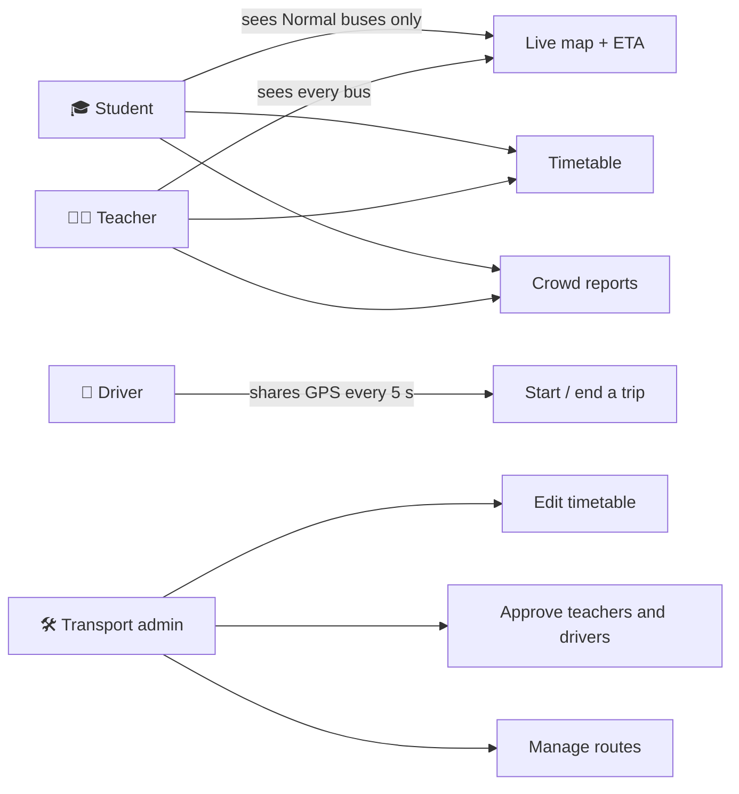

| Role | How they get in | What they do |
| --- | --- | --- |
| **Student** | Roll number + `@stud.kuet.ac.bd` email + email link | Track student buses, set a stop, get ETAs and alerts, report crowd |
| **Teacher** | Employee ID + KUET staff email + email link + admin approval | Same as students, but for every bus |
| **Driver** | Driver ID + admin approval | Pick today's trip and share the bus location |
| **Transport admin** | Set up by the transport office in Firebase | Keep the timetable up to date, approve accounts, add routes |

---

## The big picture

The app talks to three outside services: **Firebase Authentication** for accounts, **Cloud Firestore** as a live database, and the **OSRM routing API** for travel times. Nothing runs on a server of my own. The driver's phone writes, and every rider's phone listens.

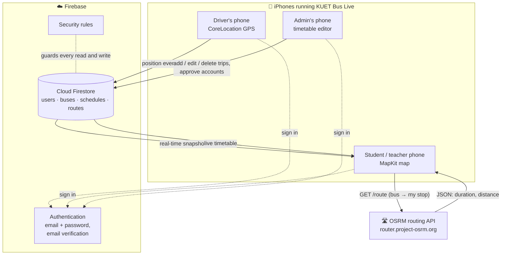

The key idea is that **nobody polls**. Firestore pushes every change to the phones that are listening, so a bus moving on the driver's phone shows up on everyone's map about a second later.

---

## How the code is organised

The app follows **MVVM** (Model, View, ViewModel), the same pattern used in the lab classes.

- **Models** are plain `struct`s that match Firestore documents.
- **ViewModels** are `ObservableObject` classes. They talk to Firebase and publish data with `@Published`.
- **Views** are SwiftUI screens. They only show what the view model publishes.
- **Services** wrap system frameworks: GPS, notifications, the routing API, and the KUET ID rules.

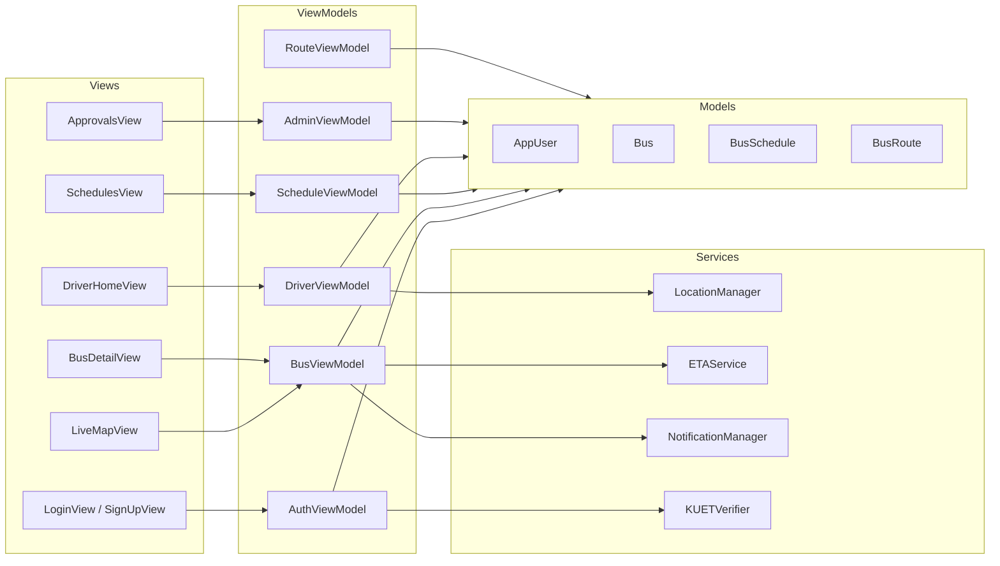

```
KUETBusLive/
├── KUETBusLiveApp.swift        App entry, configures Firebase
├── ContentView.swift           Picks the first screen (login, verify, waiting, or the role's tabs)
├── Models/
│   ├── AppUser.swift           User profile + UserRole enum
│   ├── Bus.swift               A running bus + CrowdLevel enum
│   ├── BusRoute.swift          A route and its stops
│   ├── BusSchedule.swift       One timetable trip + BusAudience, TripDays, TripPeriod
│   ├── Timetable.swift         Reads kuet_schedule.json
│   └── RouteResponse.swift     OSRM JSON response
├── Services/
│   ├── LocationManager.swift   GPS, with a custom delegate protocol
│   ├── ETAService.swift        Calls the OSRM REST API
│   ├── NotificationManager.swift  Local arrival alerts
│   └── KUETVerifier.swift      Roll number and KUET email rules
├── ViewModels/                 Auth, Bus, Driver, Route, Schedule, Admin
├── Views/                      All SwiftUI screens
└── Resources/
    └── kuet_schedule.json      Official KUET timetable
```

---

## Signing up and KUET ID verification

When you create an account, the app checks your KUET details **before** it creates anything in Firebase. `KUETVerifier.validate` uses a `switch` on your role:

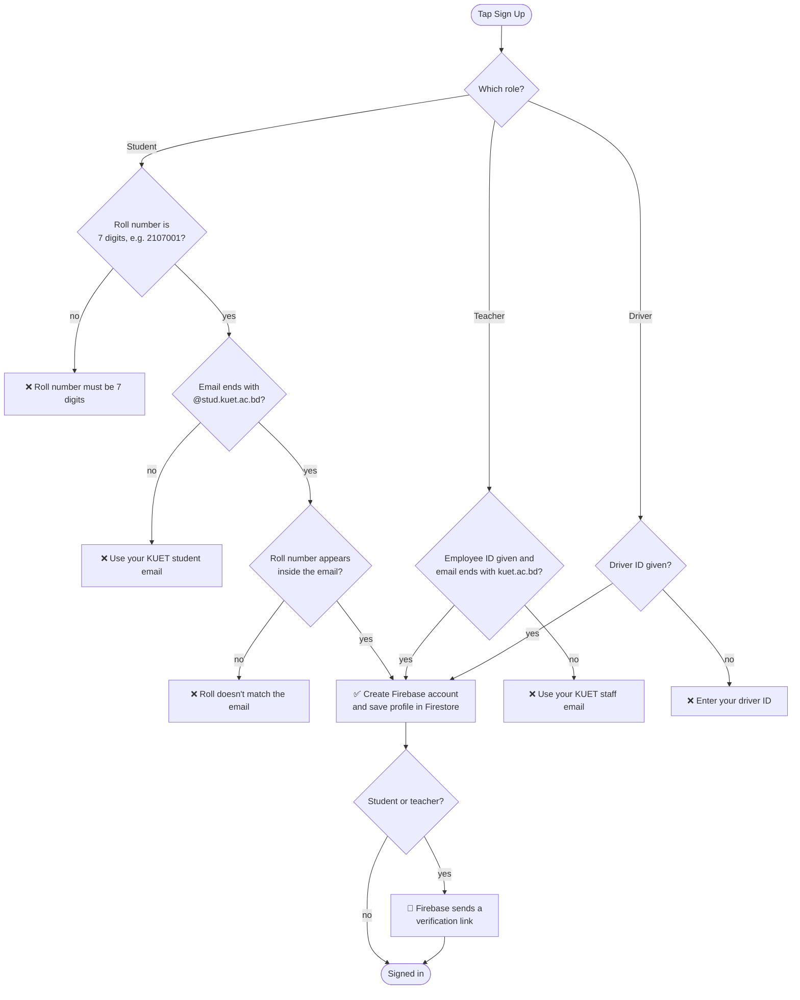

Signing up isn't the end of it. Every time the app starts, `ContentView` decides which screen you should see. Because the profile is loaded with a **live listener**, the moment the admin approves you, your phone moves past the waiting screen by itself. You don't need to sign out and back in.

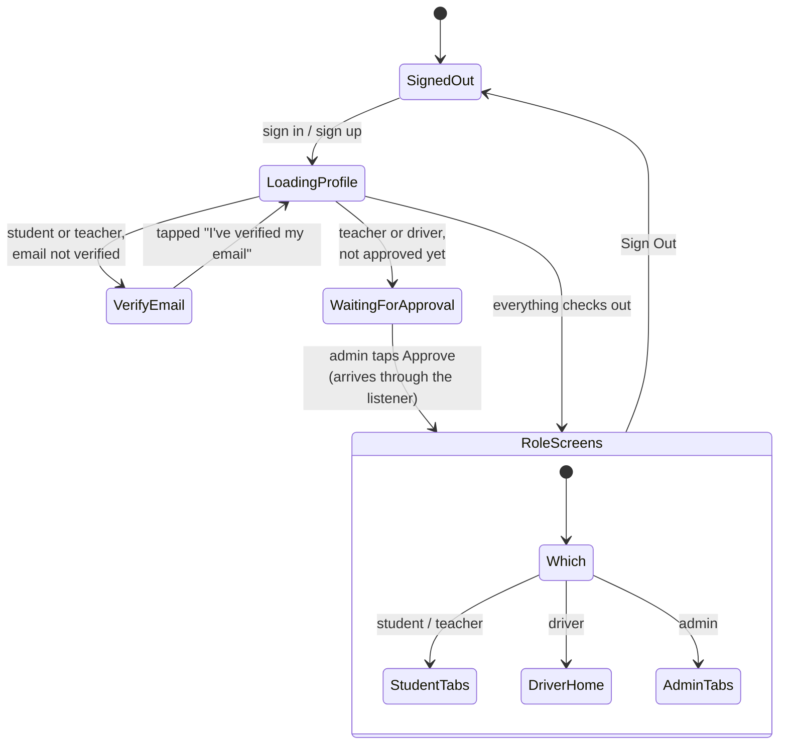

> **Demo accounts:** debug builds also accept `@test.com` emails and skip the email link, so the app can be shown in the lab without real KUET mailboxes. Release builds never accept them.

---

## Which bus can I take?

KUET runs two kinds of trips:

- **Normal** trips (Normal-1, Normal-2) are **student buses**.
- **Special** trips (Special-1, Special-1 (AC)) are **teacher buses**.

Teachers can get on any bus. Students can only get on student buses. The whole rule is one small function, `BusAudience.canBoard(_:)`:

```swift
func canBoard(_ role: UserRole) -> Bool {
    switch role {
    case .teacher, .driver, .admin:
        return true
    case .student:
        return self == .student
    }
}
```

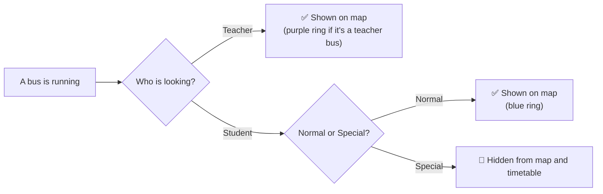

The same rule is used in four places, so it can't be dodged:

1. `BusViewModel` filters the buses on the map.
2. `ScheduleViewModel` filters the timetable.
3. `BusDetailView` hides the crowd buttons if you can't ride that bus.
4. `firestore.rules` rejects a crowd report from a student on a teacher bus, even if someone edits the app.

---

## Live tracking, step by step

This is the heart of the app. It uses the **delegate pattern** twice: Apple's `CLLocationManagerDelegate`, and my own `LocationUpdateDelegate` protocol, so the GPS code stays separate from the Firebase code.

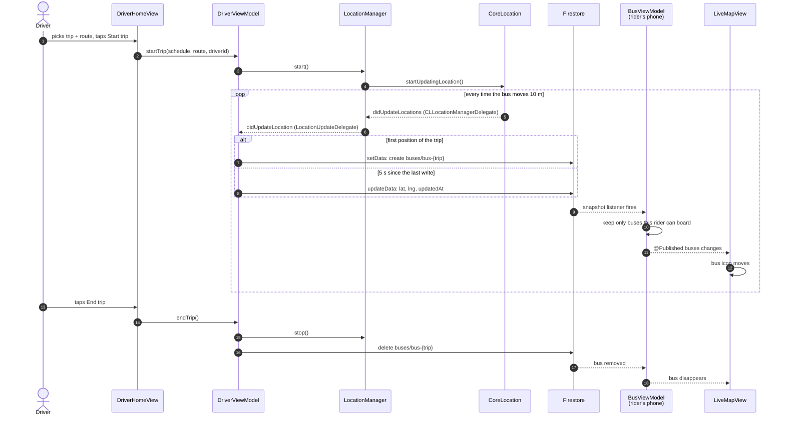

Two small choices here are worth calling out:

- **Writes are limited to one every 5 seconds.** GPS can fire many times a second, and writing every update would waste battery and Firestore quota.
- **Later updates use `updateData`, not `setData`.** That way only the position changes, and crowd reports that riders sent in the meantime aren't overwritten.

---

## How the ETA is calculated

Straight-line distance would be wrong in Khulna's roads, so the app asks **OSRM**, a free routing server, for the actual driving time. The answer comes back as JSON and is decoded with `Codable`.

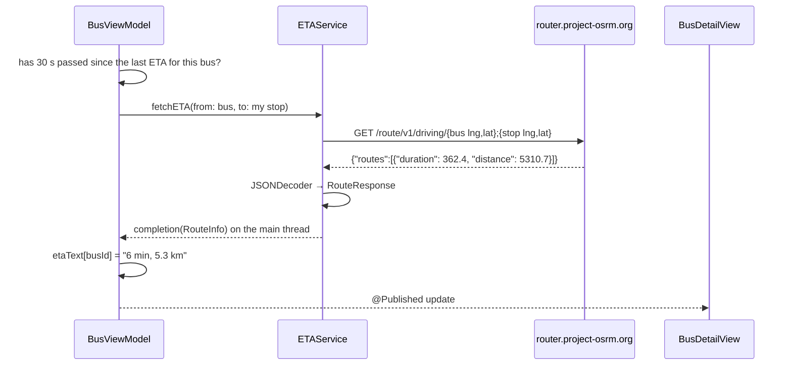

The response is mapped to two small structs:

```swift
struct RouteResponse: Codable {
    let routes: [RouteInfo]
}

struct RouteInfo: Codable {
    let duration: Double   // seconds
    let distance: Double   // metres
}
```

OSRM's public server has fair-use limits, so the app asks **at most once every 30 seconds per bus**, unless you open the bus screen or change your stop.

---

## The arrival alert

If you turn on **"Alert me 5 min before my bus arrives"** in your profile, every new ETA is checked against that limit. The alert fires once per bus, so it won't keep buzzing.

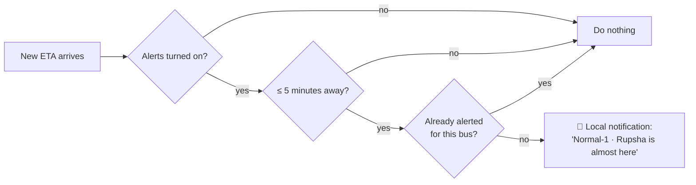

`NotificationManager` is the `UNUserNotificationCenterDelegate`, so the banner shows even while the app is open.

---

## The bus timetable

The official timetable is on [kuet.ac.bd/transport](https://www.kuet.ac.bd/transport), and it changes from time to time. So it isn't hard-coded into the screens. It lives in Firestore, where the transport admin can change it from inside the app, and every phone sees the change straight away.

The first copy ships with the app as `kuet_schedule.json`: 31 trips across Sunday to Thursday and Saturday, split into morning, noon, afternoon and night.

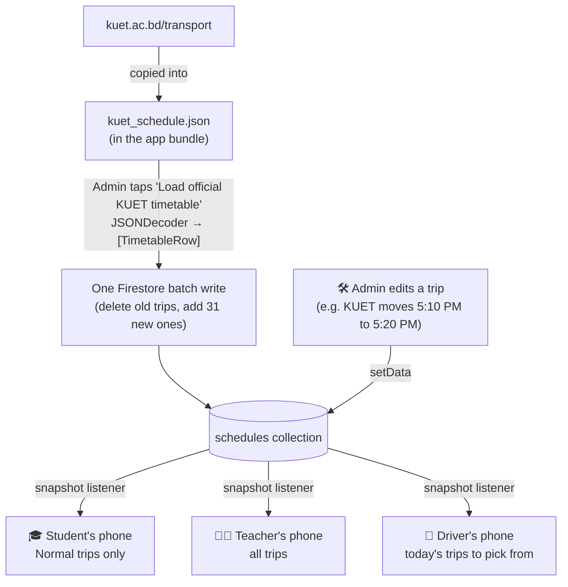

Each trip looks like this in the JSON file:

```json
{
  "tripName": "Normal-1",
  "days": "sunToThu",
  "period": "morning",
  "campusTime": "06:30",
  "spot": "Rupsha",
  "spotTime": "07:10",
  "remarks": "Will back via Royal Mor & Ferighat"
}
```

There's no `audience` field in the file. The app works it out from the name: anything starting with "Special" is a teacher bus. The admin's editor does the same, so typing "Special-2" flips the badge to *Teacher bus* automatically.

The timetable screen also shows **"Next bus you can take today"**. It checks today's weekday (Sunday to Thursday, Saturday, or no buses on Friday), compares the times with the clock, and only looks at trips your role can ride.

---

## Crowd reports

Anyone allowed on a bus can tap **Seats available** or **Full**. The report is a single field update on the bus document, so it reaches every other rider almost instantly, and the bus icon on the map changes colour.

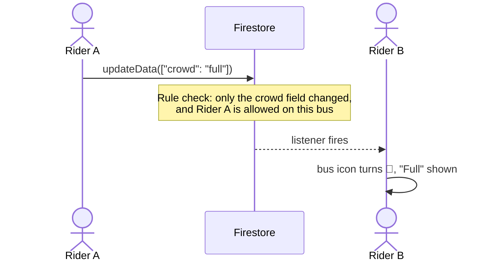

| Crowd level | Map colour |
| --- | --- |
| No report yet | ⚪ grey |
| Seats available | 🟢 green |
| Full | 🔴 red |

---

## Screens and navigation

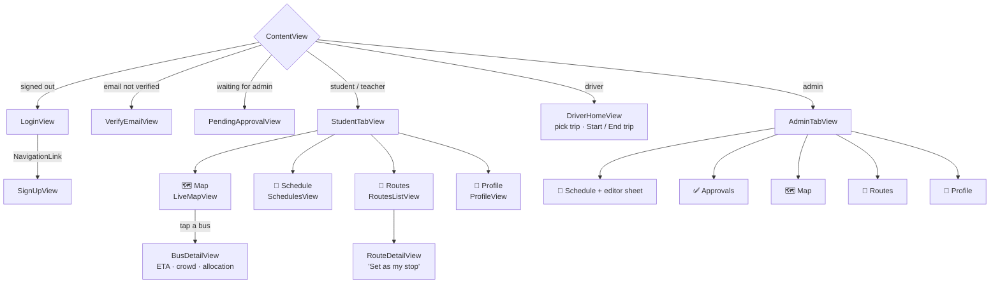

---

## Listeners, onAppear and onDisappear

Every live list in the app follows the same pattern: start listening when the screen appears, and remove the listener when it goes away. This keeps the app from downloading updates for screens nobody is looking at.

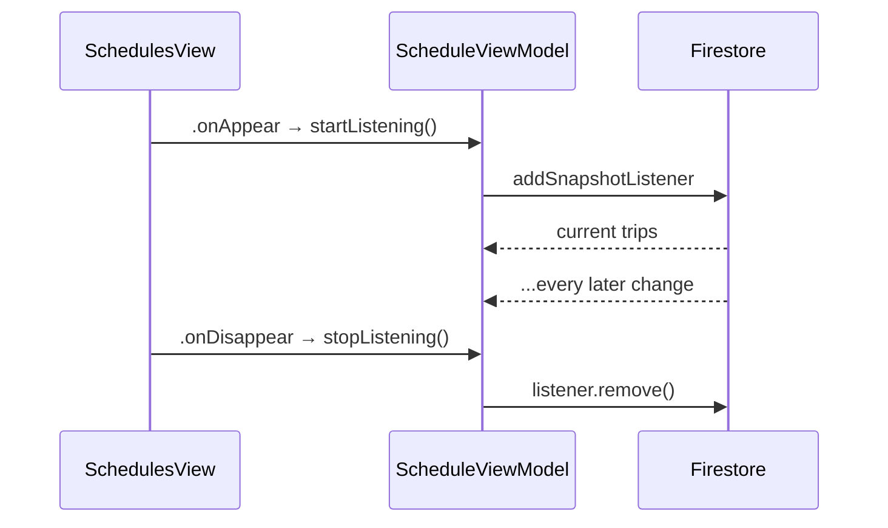

| Screen | What it listens to |
| --- | --- |
| `LiveMapView` | running buses |
| `SchedulesView` | the timetable |
| `RoutesListView` | routes and stops |
| `DriverHomeView` | routes and today's trips (also ends the trip if you leave) |
| `ApprovalsView` | teachers and drivers waiting for approval |
| `AuthViewModel` | your own profile (so approval shows up instantly) |

---

## Firestore data model

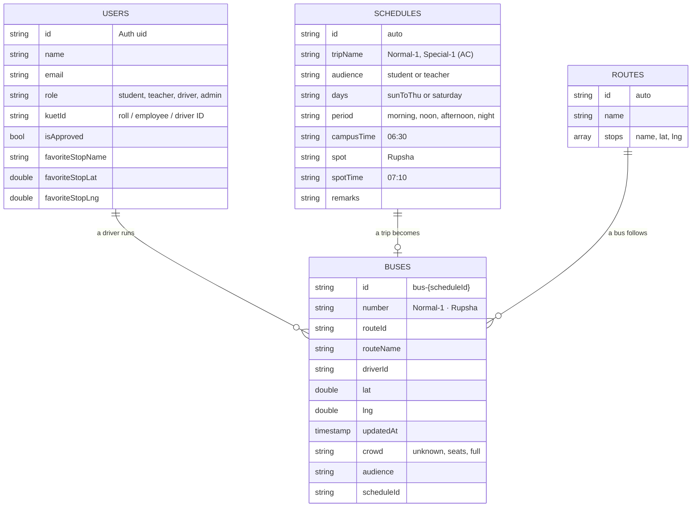

A `buses` document only exists while a trip is running. Ending the trip deletes it, which is how the bus disappears from every map.

---

## Security rules

The checks in the app are friendly, but the real protection is `firestore.rules`, which Firebase runs on the server for every request.

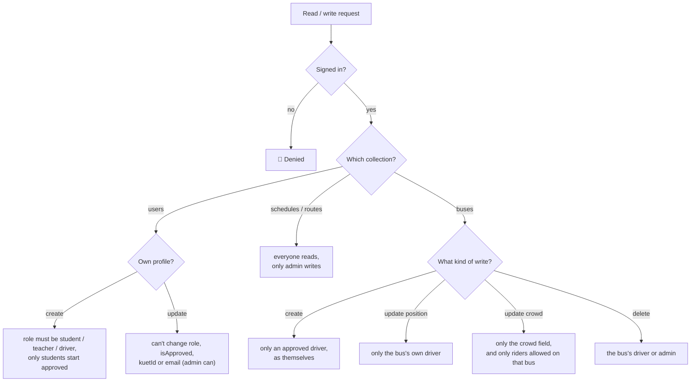

In plain words: nobody can make themselves an admin, nobody can approve themselves, only approved drivers can put a bus on the map, and a student can't touch a teacher bus.

---

## Course topics used

| Topic | Where to find it |
| --- | --- |
| Optionals, `guard let`, `??` | `AppUser.favoriteStop`, `Bus.allocation`, `DriverViewModel.startTrip`, `BusDetailView` |
| `enum` + `switch` | `UserRole`, `BusAudience`, `TripDays`, `TripPeriod`, `CrowdLevel`, `KUETVerifier.validate`, `ContentView` |
| Closures and completion handlers | `AuthViewModel`, `ETAService.fetchETA`, every snapshot listener, `filter` / `sorted` / `map` |
| Structs vs classes, computed and `static` properties | Models are structs, view models are classes; `BusSchedule.isUpcoming`, `ETAService.baseURL` |
| Protocols and the delegate pattern | `LocationUpdateDelegate` (my own), `CLLocationManagerDelegate`, `UNUserNotificationCenterDelegate` |
| `@State`, `@Binding` | `RolePicker`, `DaysPicker`, `AudiencePicker`, `SchedulePicker`, `ArrivalAlertToggle` |
| `@StateObject`, `@ObservedObject`, `@EnvironmentObject`, `@AppStorage` | View models, shared `AuthViewModel`, the alert toggle |
| Navigation | `NavigationStack`, `NavigationLink`, `.navigationDestination`, `TabView`, `.sheet` |
| Firebase Authentication | Sign up, sign in, sign out, email verification |
| Firestore add / read / update / delete | Profiles, trips, routes, buses, approvals, and one batch write |
| JSON parsing | `ETAService` + `RouteResponse` (OSRM REST API) and `Timetable` (`kuet_schedule.json`) |
| `onAppear` / `onDisappear` | Every listener screen in the table above |
| MapKit, CoreLocation, local notifications | `LiveMapView`, `LocationManager`, `NotificationManager` |

---

## Continuous integration

Every push to `main` and every pull request is built on GitHub Actions, so a broken build shows up straight away.

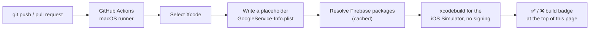

The real `GoogleService-Info.plist` is never committed. CI only needs a placeholder to compile.

---

## Setup

1. **Clone and open.** Clone the repository and open `KUETBusLive.xcodeproj` in Xcode 26 or later. Xcode fetches the Firebase packages (**FirebaseAuth**, **FirebaseFirestore**) from `Package.resolved` the first time.
2. **Add your Firebase config.** `GoogleService-Info.plist` isn't in the repository because it holds project keys. In the [Firebase console](https://console.firebase.google.com/), create a project, add an iOS app with the bundle ID `KUETBusLive` (or change the bundle ID to match yours), download `GoogleService-Info.plist`, and put it in the `KUETBusLive/` folder next to `KUETBusLiveApp.swift`.
3. **Turn on Firebase features.** Enable **Authentication > Email/Password**, create a **Firestore** database, put your project ID in `.firebaserc`, then deploy the rules:
   ```
   firebase deploy --only firestore:rules
   ```
4. **Signing.** In the target's **Signing & Capabilities**, choose your team. Keychain Sharing and the location permission text are already set.
5. **Make an admin.** Run the app and sign up. In the Firebase console, open **Firestore > users > (your uid)** and change `role` to `admin`.
6. **Load the data.** As the admin, tap **Load official KUET timetable** in Schedule and **Add sample KUET routes** in Routes.
7. **Add a driver.** Sign up a driver on another simulator and approve them in **Approvals**.

The deployment target is iOS 17.0, because the new `Map` API needs it. If Xcode reports concurrency errors, set **Build Settings > Swift Language Version** to **Swift 5**.

---

## Running a demo with two simulators

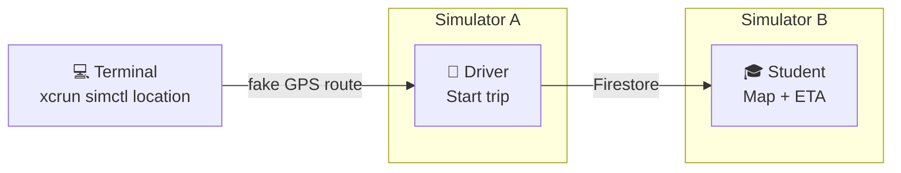

1. Run the app on one simulator and sign in as an approved **driver**. Pick a trip and tap **Start trip**.
2. Pick a second simulator in Xcode and run again. Sign in as a **student**, set a stop in **Routes**, and open the **Map**.
3. Make the driver's simulator "drive" from KUET towards Sonadanga:

   ```
   xcrun simctl list devices booted
   xcrun simctl location <driver-simulator-id> start --speed=12 22.8999,89.5024 22.8660,89.5170 22.8170,89.5440
   ```

   Stop it with `xcrun simctl location <driver-simulator-id> clear`. The coordinates are approximate.

Things worth showing in a demo: start a **Special** trip and notice the student can't see it while a teacher can; tap **Full** on one phone and watch the icon turn red on the other; change a trip time as admin and watch the timetable update on the student's phone.

---

## Limitations and ideas for later

- The routes and stop coordinates are approximate. A future version could let the admin draw routes on the map.
- The public OSRM server is meant for light use. A real deployment would host its own OSRM instance.
- Location sharing only runs while the driver's app is open. Background location would need extra permission and battery care.
- Students who belong to a specific route could get a personal "my bus" view and push notifications from a server.

---

Made with care at KUET by **Muttakin Rahman Shoscho**.
